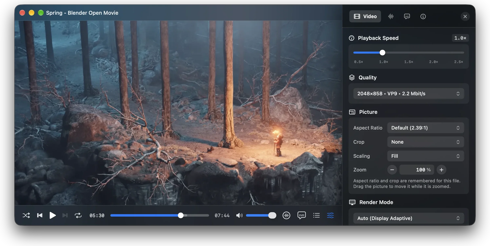

#  Nits

A video player for macOS built on VideoToolbox, Metal and FFmpeg.



## Install

```bash
brew install --cask ghotriw/tap/nits
```

Or download the zip from [Releases](https://github.com/ghotriw/nits/releases). The app is ad-hoc signed, not
notarized: after unzipping, run `xattr -dr com.apple.quarantine Nits.app`, or open it once and allow it in
System Settings → Privacy & Security → Open Anyway. The Homebrew cask does this for you.

## Features

**Video & HDR**
- HDR10, HDR10+, HLG and Dolby Vision on XDR displays; BT.2390 tone mapping to SDR on other screens, scene-adaptive
  from Dolby Vision (Profiles 5, 8.1, 8.4) and HDR10+ dynamic metadata
- HEVC, H.264, AV1, VP9 and Apple ProRes decoded in VideoToolbox (in hardware where the chip has it, AV1 on M3 and
  later, dav1d otherwise); DNxHR, VC-1, MPEG-1/2, MPEG-4 Part 2 (DivX / Xvid), VP8, Theora, RealVideo and any other
  codec FFmpeg decodes in software
- Interlaced video deinterlaced on the GPU, a frame per field (50 / 60 fps)
- Aspect ratio override, crop, Fit / Fill / Stretch / Original Size, zoom and pan
- Screenshots, timeline thumbnails, chapters, Picture in Picture

**Audio**
- Multichannel 5.1 / 7.1 and Spatial Audio, track switching, audio-only playback
- External audio tracks: a dub or commentary in a file of its own, picked up next to the video or added by hand
- Audio delay adjustment, remembered per file

**Subtitles**
- SRT, WebVTT, MicroDVD, SAMI with customizable styling; ASS / SSA rendered by libass
- Bitmap subtitles: PGS (Blu-ray), VobSub (DVD), DVB; CEA-608 closed captions
- Subtitle files next to the video picked up automatically; drag and drop; a second track shown at once; delay,
  position and scale

**Streaming**
- HTTP / HTTPS with custom headers, read ahead
- HLS with adaptive bitrate and a manual quality picker
- Video sites (YouTube and others) through yt-dlp, found on the system (`brew install yt-dlp deno`), with
  SponsorBlock skip buttons

**Player**
- Keyboard-first: layout-independent shortcuts, scrubbing with a held arrow key, frame stepping, playback speed
- OSD, Quick Settings, customizable control bar
- Playlists (M3U, PLS, XSPF, CUE) and folders; resume where you left off, recent media
- macOS integration: Now Playing media keys, Control Center, sleep prevention

**Embedding**
- `NitsKit` / `NitsCore` for host apps: a player window, the player with its controls in a window of the
  host's (`PlayerSession`), or a bare video view with an engine API
- Media server client hooks: skip intro / next episode buttons, Up Next cards, host-driven episode queue

Planned: night mode (dynamic range compression), black-bar detection. Details and status:
[docs/ROADMAP.md](docs/ROADMAP.md).

## API Usage

> [!NOTE]
> Pre-1.0: the `NitsKit` / `NitsCore` API may change between minor versions.

Add `Nits` to your `Package.swift`:

```swift
dependencies: [
    .package(path: "../nits") // or git repository URL
],
targets: [
    .target(
        name: "YourApp",
        dependencies: [
            .product(name: "NitsKit", package: "nits")
        ]
    )
]
```

### High-level Window API (`NitsKit`)

#### Opening media

```swift
import NitsKit

let controller = PlayerWindowController()

// Stream remote media with custom auth headers, title, poster, and start time:
controller.openStream(
    url: URL(string: "https://media.server/stream.mkv")!,
    title: "Movie Title", // Optional; falls back to URL filename/host
    artworkURL: URL(string: "https://media.server/poster.jpg"), // Optional; displayed in Now Playing / Control Center
    headers: ["Authorization": "Bearer secret_token"],
    startTime: 120.0,     // Optional; overrides local resume history (0 starts from the beginning)
    audioTrack: "jpn",    // Optional; track id, "stream:N" (container stream index), or language/title; overrides history
    subtitleTrack: "eng"  // Optional; track id, "stream:N", language/title, or "off"/"none"; overrides history
)

// Open local media file (automatically extracts embedded cover art or accepts explicit artwork):
controller.openFile(
    url: fileURL,
    title: "Movie Title", // Optional; defaults to file name
    artworkData: nil, // Optional; falls back to embedded file artwork (MP4 covr / MKV attachment / ID3)
    startTime: nil // Pass nil to automatically resume from saved position (if enabled)
)
```

#### Events

```swift
controller.onTimeUpdate = { currentTime, duration in
    // Called periodically (every ~0.1s during active playback)
}

controller.onPlaybackStateChanged = { state in
    // .idle, .loading, .playing, .paused, .completed, .failed(String)
}

controller.onPlaybackEnded = {
    // Media finished playing to the end
}

controller.onClose = { finalTime, duration in
    // Window was closed by user; provides final playback time and duration before stop()
}
```

#### Media server clients

A host that plays episodes from its own server (Emby, Jellyfin, Plex) keeps the series, the markers and the queue;
Nits shows the controls and reports what the user did. Everything below is per load: each `openStream` replaces the
previous media's buttons and navigation, so pass them with it or set them once known. The types come from the
modules under `NitsKit`: `PlaybackActionButton` and `TrackNavigation` from `NitsCore`, `ControlsConfiguration` from
`NitsUI`.

Action buttons ("Skip Intro", "Next Episode") for spans of the timeline. The host decides where they go (e.g. from
its media server's intro / credits markers) and what they do. A button with a subtitle or artwork shows as an
"Up Next" card:

```swift
import NitsCore
import NitsKit
import NitsUI

controller.setActionButtons([
    PlaybackActionButton(id: "intro", title: "Skip Intro", start: 12, end: 72.5),
    PlaybackActionButton(
        id: "next", title: "Next Episode", start: 2666.5, // end: nil = to the end
        allowsAutoPress: false,                            // see below
        subtitle: "S2 · E5 · The Episode Name",            // Optional; makes it a card
        artworkURL: thumbnailURL),                         // Optional, 16:9; fetched without headers
])
controller.onActionButton = { id in
    if id == "intro" { controller.engine.seek(to: 72.5) } else { /* open the next episode */ }
}
```

The user picks how long a button stays up and whether it presses itself (Settings → General → Action Buttons).
Auto-press is meant for buttons like "Skip Intro"; pass `allowsAutoPress: false` for "Next Episode" unless cutting
the credits short is wanted.

Next / Previous from the host's queue. Setting `onTrackNavigation` makes the control bar, the Playback menu
(`⌘→` / `⌘←`), media keys and Control Center call the host instead of Nits' playlist; the host answers by opening
the item it moves to:

```swift
controller.onTrackNavigation = { direction in   // .next / .previous
    /* open the next or previous episode with openStream(...) */
}

controller.openStream(
    url: episodeURL,
    trackNavigation: TrackNavigation(hasNext: true, hasPrevious: true, nextTitle: "S2 · E6 · …"))

// Or later, once the host knows the next episode:
controller.setTrackNavigation(TrackNavigation(hasNext: true, hasPrevious: true, nextTitle: "S2 · E6 · …"))
```

- After calling the host, Next (or Previous) stays off until the next load, so repeated presses don't skip several
  episodes.
- Previous restarts the episode when it has played past 3 s or there's no previous one.
- With `onTrackNavigation` set the end of the media is left to the host: Nits doesn't repeat or advance, and
  `onPlaybackEnded` is the signal to auto-play the next episode.

Controls the host doesn't offer, set once at launch (not saved; the user's control bar layout is kept):

```swift
ControlsConfiguration.shared.unavailableItems = [.playlist, .playlistRepeat, .playlistShuffle]
```

They leave the control bar and the Controls settings. Without `.playlist` the side panel shows chapters only.

### Player in your own window (`PlayerSession`)

`PlayerWindowController` is one presentation of a `PlayerSession`; a host with a window of its own shows the
session's view in it instead. The callbacks, opening media and the actions above are the session's too:

```swift
import NitsKit

let session = PlayerSession()
session.onTimeUpdate = { [weak session] _, _ in
    // Where the media stands as its history tells it (a live stream's in the stream's own time), to save in the
    // host's own store; `nil` while nothing is loaded.
    if let progress = session?.engine.playbackProgress { /* save progress.position, progress.duration */ }
}
session.onClose = { finalTime, duration in /* ... */ }

// The video with the control bar, OSD and panels, in any SwiftUI container of the host's window:
session.makeContentView()
let presentation = HostWindowPresentation(session: session, window: hostWindow)

session.openStream(url: streamURL, headers: ["Authorization": "Bearer secret_token"], startTime: 120, presents: true)

// Done with the player: end the session (reports onClose, clears Now Playing, stops the engine) and give the window back.
session.end()
presentation.detach()
```

`HostWindowPresentation` gives the session what the player window has, in the host's window: its fullscreen, the
player's keys (Space, arrows, m, …), drags of the picture and the header strip moving the window, the window brought
forward when media opens, and Picture in Picture moving it aside as `AppSettings` asks. By default it takes the title
bar over as the player window has it (the player at the top of the window, the traffic lights fading with the
controls); `adoptsTitleBar: false` leaves it the host's. Closing the window ends the session (`onWindowClose`), and
`detach()` gives the window back as it was.

- In a pane, or with window handling of its own, a host does without it: it shows `session.makeContentView()`, holds a
  `PlayerKeyMonitor(actions: session, window:)` for the keys and, for fullscreen, sets `session.presentation` (a
  `PlayerPresentation`; without one the double click on the picture and `F` are left to the host). The player never
  moves the host's window unless the host asks (`uiState.movesWindow`).
- With the focus in a text input (any `NSTextInputClient`, a web view included) keys stay the host's. A SwiftUI
  window's hosting view is one too: such a host passes `ignoresResponder: { $0 is NSTextView }`, and one that wants the
  player's keys with the focus in its web view its own judgment.
- Menus: `PlayerCommands` acts on the focused session (`playerActions`).

Details: "Session and presentation" in [docs/ARCHITECTURE.md](docs/ARCHITECTURE.md).

### Logging

Player logs go through `AppLog`, which writes to `os.Logger` and to `~/Library/Application Support/Nits/player.log`. A host app can use it too:

```swift
AppLog.info(.host, "Session started")
LogViewerWindowController.shared.showLogs() // or ⌥⌘L
```

Details: [docs/LOGGING.md](docs/LOGGING.md).

### Low-level Rendering Engine (`NitsCore`)

> [!IMPORTANT]
> The engine's callbacks are single closures. With `NitsKit`, `onMediaLoaded`, `onTimeUpdate`,
> `onPlaybackStateChanged`, `onTrackNavigationChanged` and `onRelativeSeekResolved` are the session's: subscribe
> through `PlayerSession` / `PlayerWindowController`, or Now Playing and saved progress stop.

```swift
import NitsCore

let engine = PlayerEngine()

// Async loading for network streams:
await engine.loadAsync(
    MediaLoadRequest(
        path: "https://media.server/stream.mkv",
        headers: ["X-Api-Key": "my-key"],
        startTime: 300.0
    ))

// Events for a host UI (e.g. forwarded to a web view by the host's own bridge):
engine.onTracksChanged = {
    // engine.audioTracks, engine.selectedAudioTrackId, engine.subtitles.tracks, engine.subtitles.selectedTrackId
}
engine.onBufferingChanged = { isBuffering in
    // Playback is held for data; playbackState stays .playing
}
engine.onTimeUpdate = { currentTime, duration in
    // engine.bufferedTime: how far media has been read ahead
}
```

## Command-Line Options

Arguments work with `swift run`, the bundle script, and `open --args`. A flag stands over the saved setting for the
session, until that setting is changed in Settings:

```bash
swift run Nits --no-osd ~/Movies/sample.mkv
./scripts/bundle_app.sh --run --render-mode=system --audio-track=jpn ~/Movies/movie.mkv
open build/Nits.app --args --start-time=120 ~/Movies/movie.mkv
```

| Option | Description |
| --- | --- |
| `[path or URL]` | Local file or `http(s)://` stream |
| `--no-osd` | Hide the OSD |
| `--osd-duration=<sec>` | How long OSD notifications stay visible (default 1.3) |
| `--debug-osd` | Mirror log messages to the OSD |
| `--debug-osd-level=debug\|info\|notice\|warning\|error` | Minimum level shown by the debug OSD (default warning) |
| `--debug-osd-duration=<sec>` | How long each debug OSD message stays visible (default 4) |
| `--render-mode=auto\|system\|metal` | Initial render mode |
| `--no-tone-mapping` | Disable SDR tone mapping |
| `--sharpness=0.0–1.0` | Sharpening strength (default 0.5) |
| `--dovi-trims` / `--no-dovi-trims` | Apply Dolby Vision L2 trims in SDR tone mapping (default off) |
| `--local-contrast=0.0–1.0` | Texture brought back to SDR highlights by the tone mapping, 0 off (default 0.5) |
| `--volume=0.0–1.0` | Initial volume |
| `--start-time=<sec>` | Start at a given position, ignoring history (`0` starts from the beginning) |
| `--no-resume` | Don't restore the saved position |
| `--audio-track=<id\|name>` | Pick audio track |
| `--subtitle-track=<id\|name\|off>` | Pick subtitle track |
| `--header="Key: Value"` | Custom HTTP header |
| `--no-ytdl` / `--ytdl` | Don't / do open the pages of video sites through yt-dlp (default on) |
| `--ytdl-path=<path>` | The yt-dlp to run instead of the one found on the system |
| `--sponsorblock` / `--no-sponsorblock` | Skip buttons for SponsorBlock segments (sponsors, intros) via k-anonymity API (default on) |

## Requirements

- macOS 15.4+
- Apple Silicon
- FFmpeg: the app bundle ships its own LGPL build (`scripts/setup_dependencies.sh`); plain
  `swift build` / `swift test` fall back to Homebrew (`brew install ffmpeg`), which also provides
  the `ffmpeg` CLI used to generate test media
- libass (ASS / SSA subtitles) ships in the same bundle; plain `swift build` falls back to Homebrew
  (`brew install libass`)
- yt-dlp, optional, for the pages of video sites: Nits runs the one installed (`brew install yt-dlp`; YouTube also
  needs Deno, `brew install deno`), found on `PATH`, in Homebrew's, pipx's and MacPorts' directories, or set by
  `--ytdl-path`

## Building

```bash
swift build -c release
```

Build a signed `.app` bundle with embedded FFmpeg / dav1d / libass and launch it:

```bash
./scripts/bundle_app.sh --run
```

To build and test against the same LGPL libraries that ship in the bundle:

```bash
./scripts/setup_dependencies.sh
export PKG_CONFIG_PATH="$PWD/.build/dependencies/lib/pkgconfig"
```

Tests and formatting check (`format.sh` picks up `.build/dependencies` automatically):

```bash
swift test
./scripts/format.sh check
```

The repository's git hooks format staged Swift files, check commit subjects and run the checks before a push:

```bash
git config core.hooksPath .githooks
```

### Commits and releases

Commit subjects follow [Conventional Commits](https://www.conventionalcommits.org): `type(scope): description`,
with type one of `feat`, `fix`, `perf`, `refactor`, `build`, `docs`, `test`, `ci`, `style`, `chore`, `revert`, and a
`!` before the colon (or a `BREAKING CHANGE: …` paragraph) for a change that breaks the API hosts use.

The next version is worked out from them since the last tag. Before 1.0 a breaking change raises the minor version
and anything else the patch, so a host pinned with `.upToNextMinor(from:)` gets every fix and feature and no break;
from 1.0 it is SemVer's (breaking → major, `feat` → minor, else patch).

```bash
./scripts/release.sh                # the next version and its release notes; changes nothing
./scripts/release.sh --tag --push   # tag it (the notes are the tag's message) and push: release.yml publishes it
```

## License

[MIT](LICENSE)

Bundled FFmpeg (LGPL-2.1+), dav1d (BSD-2-Clause), libass (ISC) with FreeType, HarfBuzz, FriBidi and libunibreak, and the mpv-derived tone-mapping shader
(LGPL-2.1+), keep their own licenses — see [THIRD_PARTY_NOTICES.md](THIRD_PARTY_NOTICES.md).
