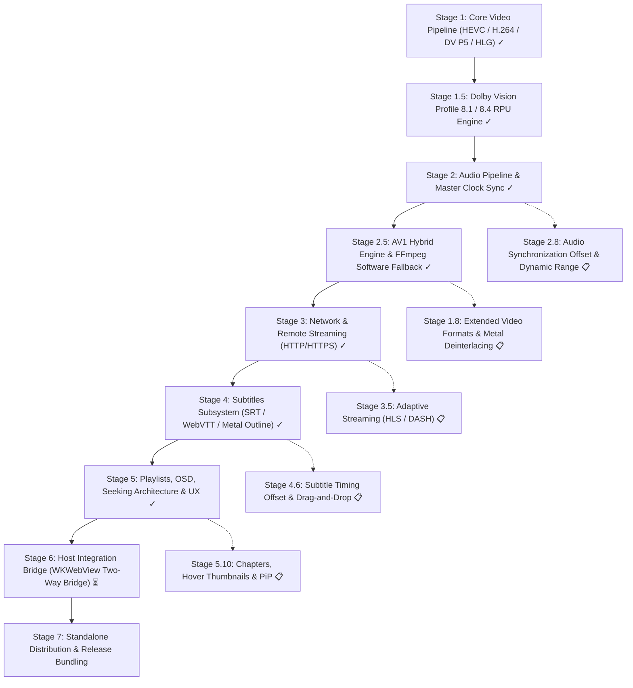

# Nits: Architecture & Roadmap

This document outlines the architecture, current implementation status, and development roadmap for `Nits`.

The goal is to evolve the Apple Silicon dual-engine video rendering core into a full-featured standalone media player with hardware-accelerated and software decoding, studio-grade synchronized audio, advanced subtitles, network streaming, playlist management, and host integration capabilities (including a bidirectional `WKWebView` bridge for Emby and Jellyfin clients).

---

## 1. Architectural Baseline & System Invariants

- **Target Platform:** macOS 15.0+ (Sequoia) / Apple Silicon (ARM64).
- **Language Standard:** Swift 6 with complete concurrency checking enabled (`-strict-concurrency=complete`, `ExistentialAny`).
- **Framework Stack:** Metal, QuartzCore (`CADisplayLink`), AVFoundation (`AVSampleBufferAudioRenderer`, `AVSampleBufferRenderSynchronizer`, `AVSampleBufferDisplayLayer`), VideoToolbox, CoreAudio, FFmpeg (`libavformat`, `libavcodec`, `libswresample`, `libdav1d`), Swift Observation (`@Observable`).
- **Modular SPM Decomposition:**
  - `NitsCore`: Headless engine core with zero SwiftUI dependencies (demuxing, decoding, ring buffers, Metal BT.2390 shaders, A/V synchronization, IOKit display sleep assertions, playback history, playlists, subtitle parsing).
  - `NitsKit`: Windowing, lifecycle, and macOS AppKit integration layer (`PlayerWindow`, `PlayerWindowController`, `PlayerCommands`, `NowPlayingController`, `LogViewerWindowController`).
  - `NitsUI`: Pure declarative SwiftUI presentation layer (controls overlay, telemetry HUD, OSD notifications, Metal-outlined subtitles, shared side panel hosting playlist and quick settings, Jump to Time dialog, Open URL sheet).
  - `NitsApp`: Application lifecycle entry point (`NSApplicationDelegate`, LaunchServices document types, CLI arguments parsing).

---

## 2. Implementation Stages Overview

---

## 3. Detailed Stage Breakdown

### Stage 1: Core Video Pipeline & Format Expansion — [COMPLETED] ✓

- [x] **1.1. Reference Dual-Engine Presentation Pipeline:**
  - **Apple Liquid Retina XDR Displays (EDR > 1.01):** Direct hardware overlay via `AVSampleBufferDisplayLayer` unlocking 1000–1600 nits peak highlights.
  - **Standard SDR Displays (EDR == 1.0, e.g., external 4K/5K monitors):** Custom Metal tone-mapping compute shader (ITU-R BT.2390 EETF, 203 nits reference white, Display P3 gamut, pure Gamma 2.2 output, AMD FidelityFX CAS 5× luma-optimized sharpening).
  - Dynamic display-adaptive handover between `.auto`, `.system`, and `.metalToneMap` with zero frame stalls or pipeline tear-down.
- [x] **1.2. Hardware HEVC / H.265 Decoding (VideoToolbox):**
  - 10-bit P010 biplanar YCbCr decoding with MSB alignment normalization (`val * 65535.0 / 1023.0`).
  - Header parsing for `hvcC` extradata configuration boxes and raw Annex B NAL byte streams.
- [x] **1.3. H.264 / AVC Support (8-bit & 10-bit SDR):**
  - Parameter set extraction for SPS (NAL 7) and PPS (NAL 8).
  - Decompression session configuration via `CMVideoFormatDescriptionCreateFromH264ParameterSets`.
  - Dynamic pixel format binding (`.r8Unorm` vs. `.r16Unorm`, Video Range vs. Full Range).
  - Direct SDR Metal render pass: BT.709 OETF $\to$ Linear BT.709 $\to$ Display P3 (Gamma 2.2) with FidelityFX CAS bypassing EETF tone-mapping overhead.
- [x] **1.4. Extended HDR Standards (HLG & Dolby Vision Profile 5):**
  - HLG (Hybrid Log-Gamma, BT.2100 / ARIB STD-B67): Inverse OETF and display-adapted OOTF gamma scaling.
  - Dolby Vision Profile 5: Extradata inspection for `dvvC`/`dvcC` boxes, IPTc2 / ICtCp matrix unpacking $\to$ LMS' $\to$ ST 2084 PQ EOTF $\to$ Linear BT.2020 in nits, eliminating green/purple tinting.
- [x] **1.5. Non-Square Pixel Aspect Ratio (SAR / DAR) Support:**
  - Dynamic extraction of `sample_aspect_ratio` from FFmpeg `AVCodecParameters` and `AVStream`.
  - Exact aspect ratio geometry calculation via `RationalAspectRatio`.
  - Automatic anamorphic frame correction across video presentation surfaces and subtitle overlays.

---

### Stage 1.5: Dynamic HDR & Dolby Vision Profile 8 (8.1 / 8.4) Engine — [COMPLETED] ✓

- [x] **1.5.1. Profile Detection & Hardware Configuration:**
  - Parse `dvvC`/`dvcC` configuration boxes from container extradata and packet side data (`AV_PKT_DATA_DOVI_CONF`).
  - Distinguish Profile 5 (ICtCp), Profile 8.1 (HDR10 PQ base layer), Profile 8.2 (SDR BT.709), Profile 8.4 (HLG), and Profile 7 (MEL/FEL).
  - Construct Apple-compliant `CMVideoFormatDescription` with `kCMVideoCodecType_DolbyVisionHEVC` (`dvh1`), enabling hardware VideoToolbox decoding with attached `DolbyVisionRPUData`.
- [x] **1.5.2. DOVI RPU Bitstream Parsing (Level 1 & Level 2 Dynamic Metadata):**
  - Parse Dolby Vision Level 1 (L1) dynamic metadata from RPU payload (NAL unit 62): frame-accurate `min_pq`, `max_pq`, and `avg_pq` with ST 2084 nits conversion.
  - Parse Dolby Vision Level 2 (L2) display trim passes for 100-nit SDR mastering targets (`target_max_pq ≈ 2081`), extracting normalized slope, offset, power, and saturation gain parameters per SMPTE ST 2094-10 / ETSI TS 103 572.
  - High-performance, zero-allocation bitstream parser with emulation prevention unescaping (`0x000003`) and boundary validation for 4K60 streams.
- [x] **1.5.3. Scene-Adaptive Tone Mapping:**
  - Forward dynamic L1/L2 metadata with frame PTS through `VTVideoDecoder` into `FrameQueue` and `CADisplayLink` rendering passes.
  - Direct application of authored 100-nit L2 trim SOP (Slope, Offset, Power) display mapping in the PQ domain before optical linear conversion, preventing double-tonemapping distortion.
  - Fallback to dynamic shot peak luminance and adaptive white point scaling via L1 with exponential moving average (EMA) temporal smoothing and scene-cut resets.
  - Telemetry reporting in Performance HUD (`Metal SDR (DoVi L2 Trim)` / `Metal SDR (DoVi L1)`).
- [x] **1.5.4. User Target White Point Calibration:**
  - User-configurable `targetNitsScale` multiplier (0.5×–2.0× in UI, 0.1×–4.0× engine bounds) to fine-tune the SDR reference luminance for ambient room lighting.

---

### Stage 2: Audio Pipeline, Hardware Master Clock & System Integration — [COMPLETED] ✓

- [x] **2.1. Hardware Master Clock Synchronization (A/V Sync):**
  - Unified playback clock driven by `AVSampleBufferRenderSynchronizer` with `AVSampleBufferAudioRenderer`.
  - CoreAudio hardware timebase anchors media timing; video presentation is paced against the synchronizer clock, eliminating lip-sync drift.
  - Clock settling guard (`ClockSettlingGuard`): transient hardware clock stabilization on seek and track changes, preventing burst frame drops in `FrameQueue`.
- [x] **2.2. Audio Demuxing & Decoding (FFmpeg libavcodec + libswresample):**
  - Concurrent packet extraction via background `audioQueue`.
  - Multi-threaded decoding and resampling to 48kHz 32-bit Float Linear PCM wrapped into `CMSampleBuffer` via `FFAudioDecoder`.
  - Apple Spatial Audio and multichannel surround (5.1 / 7.1) support via standard CoreAudio tags (`kAudioChannelLayoutTag_AudioUnit_5_1`, `kAudioChannelLayoutTag_AudioUnit_7_1`).
  - Planar buffer access via `extended_data` in `swr_convert` (guaranteeing crash-free operation with $>8$ audio channels).
  - Dynamic on-the-fly resampler recreation upon stream sample rate, channel count, or layout alterations.
- [x] **2.3. Queue Management & Live Track Switching:**
  - Non-blocking `audioFeedQueue` feeding `AVSampleBufferAudioRenderer.requestMediaDataWhenReady` with ~0.3s lead time.
  - Native backpressure handling: elimination of CPU busy-spin loops by adhering to CoreAudio buffer readiness.
  - Dynamic audio track discovery (`audioTracks`) and seamless hot-switching (`selectAudioTrack(id:)`).
  - Linear volume control (`0.0 ... 1.0`), mute toggling (`isMuted`), and volume level feedback in OSD.
- [x] **2.4. CoreAudio Route Monitoring:**
  - Real-time default audio output device monitoring via `AudioDeviceRouteMonitor` (`kAudioHardwarePropertyDefaultOutputDevice`).
  - Automatic audio rendering pipeline migration when connecting/disconnecting AirPods or external DACs.
- [x] **2.5. Audio-Only Playback Mode:**
  - Native playback for standalone audio containers and lossless formats (FLAC, MP3, AAC, OGG, Opus, WAV, ALAC, AIFF, APE).
  - Dedicated audio player UI with album artwork display (embedded ID3/Vorbis tags or remote artwork URLs), waveform visualization, and metadata badges.
- [x] **2.6. System Media Controls & Now Playing Integration:**
  - Dual-backend implementation: modern `NowPlaying.framework` (`MediaSession` on macOS 27+) with backwards-compatible `MediaPlayer` (`MPNowPlayingInfoCenter` / `MPRemoteCommandCenter`).
  - Remote command handling: Play, Pause, Toggle, Seek/Scrub, and Skip.
  - Hardware accessory support: macOS Control Center, Menu Bar Now Playing item, hardware keyboard media keys, Touch Bar, and Bluetooth headset controls.
  - Embedded and external artwork extraction and pipeline forwarding.

---

### Stage 2.5: Universal Video Decoding — AV1 & FFmpeg Software Fallback — [COMPLETED] ✓

- [x] **2.5.1. Decoder Protocol Abstraction (`VideoDecoderProtocol`):**
  - Unified decoder interface: `decode(sampleBuffer:)`, `flush()`, `drain()`, and `setOutputHandler`.
  - Dynamic backend instantiation via `VideoDecoderFactory`: transparent selection between hardware `VTVideoDecoder` and software FFmpeg decoders.
- [x] **2.5.2. AV1 Hybrid Engine (AOMedia Video 1):**
  - Hardware-accelerated decoding on Apple Silicon M3/M4+ through VideoToolbox (`kCMVideoCodecType_AV1`, OBU parsing, `av1C` atom extraction).
  - High-performance software fallback for M1/M2 chips via `libdav1d` (VideoLAN SIMD/NEON assembly through FFmpeg).
  - Vectorized UV plane interleaving and zero-copy mapping into `CVPixelBufferPool` instances with IOSurface and Metal backing.
- [x] **2.5.3. FFmpeg Software Decoder for Legacy Codecs (WMV / VC-1):**
  - Multi-threaded software decoder `FFmpegVideoDecoder` supporting Windows Media Video (WMV1, WMV2, WMV3) and VC-1 (SMPTE 421M).
  - Conversion of planar YUV420P / YUVJ420P / YUV420P10 frames directly into hardware-backed `CVPixelBuffer`s (NV12 / P010).
  - Generation token tagging (`generation token`) in frame queues, atomically discarding stale pre-seek frames during concurrent decode and flush cycles.
- [x] **2.5.4. Legacy MPEG-4 Family (DivX / Xvid / MS-MPEG4 / H.263):**
  - `FFmpegVideoDecoder` support for MPEG-4 Part 2, Microsoft MPEG-4 v1–3 and H.263 / H.263+ (AVI, 3GP, MKV, MP4).
  - AVI streams without presentation timestamps: packet metadata travels with `AV_CODEC_FLAG_COPY_OPAQUE`, PTS come from the decoder's reordering, and exact-seek preroll is decided on the real frame PTS.
- [x] **2.5.5. MPEG-1 / MPEG-2 (VCD, DVD VOB, MPEG-PS, MPEG-TS / M2TS):**
  - `FFmpegVideoDecoder` support for MPEG-1 and MPEG-2 video (4:2:0); anamorphic DVD aspect ratios from the sequence header.
  - Index-less containers (MPEG-TS / MPEG-PS): seeks sync to the next video keyframe, backing off until it precedes an exact-seek target.
  - MPEG-TS / MPEG-PS timestamps are rebased onto a zero-based timeline (`start_time`), including subtitles and thumbnails.
  - Untagged streams get BT.601 colorimetry at SD resolutions (SMPTE C / EBU primaries by line count) and BT.709 at HD.
  - Interlaced content is deinterlaced by 1.8.3.
- [x] **2.5.6. Flash & Early Web Video (Sorenson Spark, VP6, VP8, Theora):**
  - `FFmpegVideoDecoder` support for Sorenson Spark (FLV1) and On2 VP6 / VP6F / VP6A (alpha dropped) in FLV, VP8 in WebM / Matroska, and Theora in Ogg.
  - `FFmpegVideoDecoder` uses slice threading only: frame threading delays output past the few packets seek previews and frame steps decode.
  - VP6 and Theora have no FFmpeg encoder, so they lack synthetic test media.
- [x] **2.5.7. RealMedia (RealVideo 1–4, RealAudio):**
  - `FFmpegVideoDecoder` support for RealVideo 1.0–4.0 in `.rm` / `.rmvb`; RealAudio (14.4K, G2 Cook, SIPR, ATRAC3) through `FFAudioDecoder`.
  - RealVideo 3/4 (`.rmvb`) and Cook have no FFmpeg encoder, so they lack synthetic test media.
- [x] **2.5.8. Any FFmpeg-Decodable Video (libswscale fallback):**
  - `VideoCodec.software(ffmpegCodecID:)` covers every video codec FFmpeg can decode without a dedicated case (Motion JPEG, DV, Cinepak, QuickTime Animation, Indeo, HuffYUV, ProRes, DNxHD…); the stream info panel shows FFmpeg's codec name.
  - `FrameFormatNormalizer` converts frames that aren't planar 4:2:0 (4:2:2, 4:4:4, 4:1:1, RGB, palette, gray) with libswscale to 8- or 10-bit 4:2:0; RGB is encoded and tagged BT.601 at SD, BT.709 above.
  - `StreamColorimetry` accepts only real CoreVideo constants from `CV*GetStringForIntegerCodePoint`: its placeholders (e.g. "YCbCrMatrix#5" for BT.470BG / PAL BT.601) fall back to the FFmpeg mapping.

---

### Stage 1.8: Extended Video Formats & Compute Deinterlacing — [PLANNED]

> Broaden codec compatibility for web rips and broadcast media while eliminating interlacing combing artifacts.

- [x] **1.8.1. VP9 Codec Integration (WebM / YouTube Streams):**
  - VideoToolbox hardware decode path for VP9 Profile 0 (8-bit) and Profile 2 (10-bit HDR) where supported.
  - Software decoding fallback via `FFmpegVideoDecoder` (`libvpx-vp9` / native FFmpeg VP9).
  - Mapping of WebM container metadata (Color config, mastering display metadata, MaxCLL/FALL).
- [ ] **1.8.2. Professional Production Codecs (Apple ProRes & Avid DNxHR):**
  - Native hardware/framework VideoToolbox decoding for Apple ProRes family (`kCMVideoCodecType_AppleProRes422`, `ProRes422HQ`, `ProRes422LT`, `ProRes422Proxy`, `ProRes4444`, `ProRes4444XQ`).
  - FFmpeg software decoding for Avid DNxHD / DNxHR with high-bitdepth P010/NV12 pool allocation.
  - Until then ProRes and DNxHD play through `FFmpegVideoDecoder` (2.5.8), with chroma reduced to 4:2:0.
- [x] **1.8.3. Metal Compute Deinterlacing:**
  - Interlaced frames (`AV_FRAME_FLAG_INTERLACED` / `TOP_FIELD_FIRST`) are deinterlaced in `FFmpegVideoDecoder` by `MetalDeinterlacer` (`Deinterlace.metal`) before they reach the frame queue, seek preview or step cache: one progressive frame per interlaced frame, keeping the first field, weaving the second where it fits between its neighbours and interpolating along edges where it combs. No frame history, so no added latency.
  - Interlaced H.264 (1080i broadcast, AVCHD) is decoded by FFmpeg: Apple Silicon's VideoToolbox rejects field-coded H.264 (`kVTVideoDecoderBadDataErr`). `FFmpegVideoDecoder` takes the `avcC` / `hvcC` from the format description because samples arrive length-prefixed.
  - MPEG-TS / MPEG-PS rewind to byte 0 after probing: the timestamp rewind landed past the first packet and lost the opening keyframe (H.264 dropped its whole first GOP).
- [x] **1.8.4. Field-Rate Deinterlacing (50 / 60 fps output):**
  - Streams declared interlaced (`field_order`, or standard-definition DV, interlaced by format) get a progressive frame per field: `MetalDeinterlacer` runs `deinterlacePlane` once per field in one command buffer, the second frame presenting a field later (`FieldTiming`, honouring `repeat_pict`). Each frame still comes from its own interlaced frame, so there is no latency or frame history and seek previews and frame steps work as before. Frames flagged interlaced in streams that don't declare it keep one frame per frame.
  - The engine paces such streams at the field rate (`outputsFieldRate`): display-link rate, frame-queue lead window, exact-seek floor and frame steps (a field per step).
  - Exact seeks can land on a second field: the demuxer attaches the seek target to every preroll sample and `FFmpegVideoDecoder` decides visibility per field.
  - Motion is confirmed against the previous frame (causal, so still no latency): a line that looks combed but hasn't changed since that frame is woven, so fine still detail (thin horizontal lines) no longer flickers between the two fields' frames. The history is one source frame, dropped on flush and ignored unless the next frame follows it directly.
  - Fields that show the same moment (film in 50i / 60i, PsF, DV shot progressive, still scenes) stay one frame for the whole interlaced frame, so frame steps don't stall on repeats. The shader counts moving samples whose rows alternate over three lines between the fields and within one field; fields differ only when the first clearly outnumbers the second, which moving texture and noise produce alike.
  - The Video pane of Quick Settings offers the mode for interlaced content: Auto (frame per field), Frame per Frame, Off. Switching re-seeks to the current frame; the choice lasts the session.

---

### Stage 2.8: Audio Synchronization Offset & Dynamic Range Management — [PLANNED]

> Solve wireless audio latency and improve dialogue intelligibility during wide dynamic range film playback.

- [ ] **2.8.1. Manual Audio Synchronization Delay (A/V Sync Offset):**
  - User-configurable audio timestamp offset (`audioDelaySeconds: -1.0 ... +1.0`) to compensate for third-party Bluetooth latency and external DSP pipelines.
  - Runtime adjustment without pipeline teardown via OSD and Quick Settings (`Audio` pane).
  - Keyboard shortcuts (`G` / `F`) adjusting delay in ±50ms steps with instant feedback.
- [ ] **2.8.2. Dynamic Range Compression & Night Mode:**
  - Audio processing filter stage in `FFAudioDecoder` or CoreAudio AudioUnit graph.
  - Night Mode / Voice Boost: dynamic range compression raising low-level dialogue while softly limiting explosive peaks and loud effects.

---

### Stage 3: Remote Network & Stream Playback (HTTP/HTTPS) — [COMPLETED] ✓

- [x] **3.1. Remote URLs & Custom HTTP Authorization:**
  - Demuxer initialization with custom parameters: `MediaDemuxer.init(url:headers:interruptContext:)`.
  - Pass custom HTTP request headers to FFmpeg via `AVDictionary` (CRLF-formatted strings: `Authorization: Bearer ...`, `X-Emby-Token`, `User-Agent`).
  - Resilient network options: automatic reconnection (`reconnect`, `reconnect_streamed`, `reconnect_delay_max`) and 10s microsecond I/O timeouts (`timeout`, `rw_timeout`).
  - Unified protocol handling for `http://`, `https://`, and `file://` schemes.
- [x] **3.2. Asynchronous Buffering, Interruption & UI:**
  - Non-blocking asynchronous loading via `loadAsync(path:headers:)`.
  - Immediate network cancellation via `AVIOInterruptCB` (`InterruptContext`) on window close or media switch without thread hangs.
  - Playback loading state tracking (`isLoading`) and error presentation with dedicated banners.
  - "Open URL…" modal sheet with preset authentication headers and `⌘U` shortcut.
  - Command-line argument parsing for `--header="Key: Value"` in `PlayerConfiguration`.
- [ ] **3.3. Fast Stream Start:**
  - Measure `avformat_open_input` / `avformat_find_stream_info` time on live MPEG-TS / IPTV sources; probing currently runs with FFmpeg defaults (`probesize` 5 MB, `analyzeduration` 5 s).
  - Tune `probesize` / `analyzeduration` for network streams without missing late-appearing audio streams (e.g. AC-3 in TS).

---

### Stage 3.5: Adaptive Bitrate Streaming (HLS & MPEG-DASH) — [PLANNED]

> Support modern adaptive web media streams with multi-rendition quality switching.

- [ ] **3.5.1. HTTP Live Streaming (HLS) Multi-Rendition Demuxing:**
  - Parsing master playlists (`.m3u8`) with multiple variant audio and video renditions.
  - Dynamic stream selection (bandwidth adaptive or manual rendition picker in Quick Settings).
- [ ] **3.5.2. MPEG-DASH Integration:**
  - Parsing `.mpd` manifests and segmented MP4/WebM initialization fragments.

---

### Stage 4: Subtitles Subsystem (SRT, WebVTT & Metal Outlines) — [COMPLETED] ✓

- [x] **4.1. Text-Based Subtitle Parsers (SRT, WebVTT):**
  - Robust parser for standard SubRip (`.srt`) and WebVTT (`.vtt`) files.
  - Stripping of HTML formatting tags (`<b>`, `<i>`, `<u>`, ``) while maintaining cue timing.
  - Chronological cue indexing with $O(\log N)$ binary search lookup supporting simultaneous and overlapping dialogue lines.
- [x] **4.2. Embedded Subtitle Demuxing:**
  - Traversal and extraction of subtitle streams (`AVMEDIA_TYPE_SUBTITLE`) from MKV and MP4 containers (`subrip`, `webvtt`, `mov_text`).
  - Metadata parsing: language codes, titles, `isForced`, and `isSDH` flags.
- [x] **4.3. Dynamic Positioning & ASS/SSA Tags:**
  - Parsing of ASS/SSA alignment tags (`{\an1}` – `{\an9}`).
  - Dynamic positioning in `SubtitleOverlayView`: top-aligned cues render at the top of the display surface without colliding with bottom subtitles.
- [x] **4.4. GPU-Accelerated Outline Shader & Styling (Metal + SwiftUI):**
  - Custom stitchable Metal shader (`SubtitleOutlineModifier` / `SubtitleShaders.metal`) generating crisp, omnidirectional text outlines without blur artifacts.
  - Proportional font scaling dynamically adapting text sizes to video dimensions.
  - Comprehensive styling settings: font family, weight, point size (16–54 pt), text color, background box color, and opacity with live interactive previews.
  - Persistence across sessions via `UserDefaults`.
- [ ] **4.5. Advanced ASS/SSA Typesetting & Bitmap Subtitles:**
  - Full ASS drawing, vector shapes, and styling support via `libass` integration.
  - Bitmap subtitle overlays: PGS (Blu-ray `hdmv_pgs_subtitle`) and VOBSUB (DVD).

---

### Stage 4.6: Subtitle Timing Calibration & Drag-and-Drop Ingestion — [PLANNED]

> Compensate for out-of-sync subtitle releases and simplify subtitle loading.

- [x] **4.6.1. Subtitle Timing Offset (Subtitle Delay):**
  - Configurable timestamp shift (`PlayerEngine.subtitleDelay`, `-30.0 ... +30.0` s) applied to the cue lookup.
  - Hotkey adjustments (`Z` / `X`) stepping timing by ±200ms with real-time OSD indication.
  - Manual entry field in Quick Settings (`Subtitles` pane).
  - Remembered per file in `PlaybackHistoryStore` (not for external subtitle tracks, which aren't restored yet).
- [ ] **4.6.2. Drag-and-Drop Subtitle Attachment:**
  - AppKit drag-and-drop ingestion (`NSView.registerForDraggedTypes([.fileURL])`) in `NativeVideoHostView`.
  - Dropping `.srt`, `.vtt`, or `.ass` directly attaches the subtitle file to active playback with auto-selection.

---

### Stage 5: Playlists, Navigation Architecture, OSD & UX — [COMPLETED] ✓

- [x] **5.1. Playback Speed Control (Variable Rate):**
  - Continuous rate adjustment from 0.5× to 4.0× in 0.1× increments via keyboard shortcuts (`[`, `]`, `\`) and application menus.
  - Instant re-anchoring of `AVSampleBufferRenderSynchronizer` clock avoiding phase distortion or audio buffer underruns.
- [x] **5.2. Responsive Seeking & Scrubbing Architecture:**
  - Keyframe-aligned relative seeking: instant skips jumping directly between keyframes without decoding intermediate P/B frames.
  - Single-frame stepping forward and backward (`,`, `.`, `⌥←`, `⌥→`).
  - Burst-aware relative seeking with chase settle debouncing: preserving play intent and preventing deadlocks during rapid scrubbing.
  - "Jump to Time…" dialog (`⌘J`) for exact timestamp navigation.
  - User-configurable seek step (default 5s) and exact seek mode toggles.
- [x] **5.3. On-Screen Display (OSD):**
  - Animated transient HUD overlay in the top-left corner reporting volume levels, seek offsets with duration progress bars, play/pause states, rate changes, and track switching.
- [x] **5.4. Side Panel & Quick Settings:**
  - Shared non-modal side panel (`SidePanelContainer`, `PlayerSidePanel`) sliding in from the trailing edge: one panel open at a time, the control bars shrink beside it instead of being covered, controls stay clickable, a click on the video or `Esc` closes it. Always dark so it stays legible over bright video.
  - Quick Settings panel with categorized panes: Audio, Video, Subtitles, and Media Info.
  - Direct manipulation of tone-mapping parameters (exposure, shadow lift, target nits multiplier, CAS sharpness).
  - Detailed stream inspector: active video/audio codecs, color primaries, transfer functions, sample rates, channel configurations, and bitrates.
- [x] **5.5. Playlist Management & Directory Scanning:**
  - Reactive `@Observable` playlist engine (`PlaylistManager`).
  - Parsing external playlist formats: M3U, M3U8, PLS, XSPF, CUE.
  - Directory scanning (single folder level) when opening folders, or of the siblings when opening a single media file.
  - Side panel UI: search and filtering, active item indication, auto-scroll to current track, sorting by title, filename or duration with a separate direction toggle. Repeat (Off / All / One) and shuffle live in the control bar (5.9).
  - Persistent playlist repeat and shuffle settings via `UserDefaults`.
  - Non-blocking ingestion: playlist parsing and folder scans run off the main actor with a loading indicator, and path resolution never touches the file system, so playlists of thousands of files on network volumes open in a fraction of a second.
  - Background durations for unplayed items: container-header probe (`MediaDurationProbe`, no decoding, 5 s per-item limit) for local files and LAN media files, persisted in `MediaDurationCache` together with durations learned during playback. The total shows `≈` while some are unknown.
- [x] **5.6. Window Management & Display Sleep Prevention:**
  - `DisplaySleepManager`: IOKit power assertions (`IOPMAssertionCreateWithName`) preventing display sleep and screen savers during active video playback.
  - Cursor autohide (`NSCursor.setHiddenUntilMouseMoves`) and controls overlay fading after 2.5s of user inactivity.
  - Borderless fullscreen mode with double-click toggles and `F` / `⌃⌘F` shortcuts.
  - Low-level layout-independent ANSI keycode handling in `PlayerWindow`.
- [x] **5.7. Playback History & Resume:**
  - Thread-safe storage manager (`PlaybackHistoryStore`) using SHA-256 normalized storage keys.
  - Automatic recording and restoring of media timestamps, audio track selections, and subtitle preferences.
- [x] **5.8. Logging Architecture & Diagnostics:**
  - Structured, categorized logging via `AppLog` (`.engine`, `.video`, `.audio`, `.demuxer`, `.subtitles`, `.playlist`).
  - In-memory ring buffer log store and live viewer window (`LogViewerWindowController`, `⌥⌘L`).
  - Real-time telemetry in `PlayerPerformanceMonitor` querying Mach kernel task and thread APIs (CPU %, memory footprint, render FPS, frame delivery times).
- [x] **5.9. Modular & Customizable Player Control Bar:**
  - Fully decoupled, atomic control components (`ControlComponents.swift`) rendered dynamically from persistent configuration model (`ControlsConfiguration.swift`, `ControlBarItem.swift`).
  - Reorderable items and visibility toggles: Previous/Next Track, Seek Relative (Backward/Forward), Play/Pause, Timeline & Scrubber, Volume Slider, Audio & Subtitle Track Selectors, Playlist & Quick Settings Drawers, and integrated Playlist Repeat Mode and Shuffle buttons.
  - Dedicated macOS Settings tab ("Controls") with Drag & Drop reordering (`.onMove`) and hide/show actions, synchronized live with active player windows via `@Observable`.
  - Smart auto-hide inhibition: keeps player control bar permanently visible while actively configuring layout in Settings.

---

### Stage 5.10: Chapters, Timeline Thumbnails, Screenshots & Picture-in-Picture — [PLANNED]

> Reference desktop player ergonomics: chapter jumps, visual timeline scrubbing, HDR screenshots, and floating window playback.

- [x] **5.10.1. Container Chapters Navigation:**
  - Demuxing chapter markers (`AVChapter`) from MKV/MP4 containers, normalized into `MediaChapter` (sorted,
    missing ends filled, duplicates such as MP4's Nero `chpl` copy dropped).
  - Chapter gaps on the timeline track; the hover preview shows the chapter title above the thumbnail.
  - Previous/Next Chapter (`⌥⌘←`, `⌥⌘→` / `PageUp`, `PageDown`); "previous" restarts the current chapter
    when more than 5 s into it (mpv's `chapter-seek-threshold`); "next" stops on the last chapter.
  - Chapter list as a tab of the playlist panel (shown only when the media has chapters), `⌥⌘C` / `C` and an
    optional control bar button; side panel headers share one tab bar (`SidePanelTabBar`).
- [x] **5.10.2. Timeline Hover Seek Thumbnails:**
  - Low-priority background worker demuxing and decoding keyframes to generate thumbnail caches.
  - Floating preview popover over the timeline slider displaying frame imagery at the hovered timestamp.
- [ ] **5.10.3. Color-Accurate Screenshot Capture (Frame Export):**
  - Capture current frame (`⌘S`): export exact decoded `CVPixelBuffer`.
  - Raw HDR mode: uncompressed 10-bit PNG / TIFF retaining mastering colorimetry.
  - Tonemapped SDR mode: Display P3 snapshot after passing the Metal BT.2390 shader, capturing what is visually rendered on screen.
- [x] **5.10.4. Picture-in-Picture (PiP):**
  - Native macOS Picture-in-Picture via public `AVPictureInPictureController` + `ContentSource(sampleBufferDisplayLayer:)`
    (the video-call controller and automatic inline start are iOS-only). Toggle from View menu (`⌃⌘P`) and an
    optional control bar button.
  - Metal tone-mapping mode falls back to `.system` (system tone mapping) while PiP is active; the display link
    moves from the host view to the screen so pacing survives a hidden window.
  - Workarounds for macOS AVKit not laying out the PiP panel (unscaled mirror, stale view, opaque band); smooth
    hand-back onto the video's rect.
  - Window behaviour on enter (hide / keep open; fullscreen and minimized untouched), optional pause on enter, close
    button pauses.
  - Opt-in auto-PiP on window minimize (exit on restore). No auto-PiP on app switch: macOS windows stay visible, so
    it would only steal the video. Leaving the fullscreen Space is not a trigger.

---

### Stage 6: Host Integration Bridge (WKWebView Two-Way Bridge) — [IN PROGRESS] ⏳

> Embedding Nits as a high-performance native rendering core inside hybrid host applications (e.g., Emby / Jellyfin web shells).

- [x] **6.1. Standalone Video Canvas (`NativeVideoHostView`):**
  - Lightweight, embeddable `NSView` presenting hardware layers without intrusive native controls.
- [x] **6.2. Engine Control & Event Protocol (`PlayerEngineProtocol`):**
  - Standardized programmatic interface: authenticated stream loading (`loadAsync(path:headers:)`), timeline controls, track selection, and rate adjustments.
  - Event callback hooks: `onTimeUpdate`, `onPlaybackStateChanged`, `onRelativeSeekResolved`.
- [ ] **6.3. Bidirectional Serialization & Message Dispatch (JS Bridge):**
  - Implement `WebPlayerBridge` injecting the JavaScript runtime interface into `WKWebView`.
  - **Commands IN (JavaScript $\to$ Native via `WKScriptMessageHandler`):**
    - `play()`, `pause()`, `seek(seconds, exact)`
    - `setVolume(value)`, `setPlaybackRate(rate)`
    - `selectAudioTrack(id)`, `selectSubtitleTrack(id)`
    - `setToneMapParams(exposure, shadowLift, targetNitsScale, sharpness)`
  - **Events OUT (Native $\to$ JavaScript via `evaluateJavaScript`):**
    - `timeupdate`: `currentTime`, `duration`, `buffered`
    - `playbackstate`: `'playing'` | `'paused'` | `'buffering'` | `'ended'` | `'error'`
    - `tracksloaded`: discovered audio and subtitle tracks
- [ ] **6.4. Transparent Window Compositing:**
  - Overlay transparent `WKWebView` instances directly above `NativeVideoHostView` while forwarding mouse and keyboard events seamlessly.

---

### Stage 7: Standalone Distribution & Release Bundling — [PLANNED]

> Eliminate external dependencies on package managers (Homebrew FFmpeg) for zero-friction distribution on macOS 15+.

- [x] **7.1. App Bundle Packaging Script (`scripts/bundle_app.sh`):**
  - Assembly of `Nits.app` bundle hierarchy, resource compilation, `Info.plist` generation with document type associations, and ad-hoc code signing.
- [x] **7.2. Dynamic Library Bundling (Dylib Bundling):**
  - Copy required shared libraries (`libavformat`, `libavcodec`, `libavutil`, `libswresample`, `libswscale`, `libdav1d`) and their dependencies into `Contents/Frameworks`.
  - Rewrite dynamic linker mach-o load commands via `install_name_tool`: replace Homebrew paths with `@rpath` (`@executable_path/../Frameworks`).
  - Configure executable `LC_RPATH` headers.
- [ ] **7.3. CI/CD Automation & Release Artifacts:**
  - Bundle dependency validation with `otool -L` (guaranteeing zero non-system references outside `/System/Library`, `/usr/lib`, and `@rpath`).
  - Automated compilation, signing, and notarization of DMG/ZIP release archives via GitHub Actions.

---

## 4. Subsystem Implementation Status

| Subsystem / Feature | Module | Current Status | Notes |
| :--- | :--- | :--- | :--- |
| **Metal Tone Mapper (BT.2390 EETF)** | `NitsCore` | Completed ✓ | Display P3, 10-bit, Gamma 2.2, FidelityFX CAS |
| **Direct XDR DisplayLayer** | `NitsCore` | Completed ✓ | Hardware Direct Scanout decoupled from synchronizer |
| **Hardware VideoToolbox (HEVC / H.264)** | `NitsCore` | Completed ✓ | P010/NV12, MSB normalization, parameter set extraction |
| **Dolby Vision P5 / P8.1 / P8.4** | `NitsCore` | Completed ✓ | Hardware `dvh1`, NAL 62 RPU parser, L1/L2 SDR SOP trims |
| **AV1 Hybrid Decoder** | `NitsCore` | Completed ✓ | M3/M4+ VideoToolbox, M1/M2 fallback to `libdav1d` NEON |
| **FFmpeg Software Video Decoder** | `NitsCore` | Completed ✓ | WMV1–3, VC-1, MPEG-1/2, MPEG-4 Part 2, MS-MPEG4 v1–3, H.263, FLV1, VP6, VP8, Theora, RealVideo 1–4 and any other FFmpeg video codec (libswscale fallback) into `CVPixelBufferPool` |
| **Extended Formats: VP9** | `NitsCore` | Completed ✓ | VP9 Profile 0 (8-bit) & Profile 2 (10-bit HDR), multi-threaded software decoder |
| **Professional Production Codecs** | `NitsCore` | Planned 📋 | Apple ProRes VideoToolbox, Avid DNxHR |
| **Metal Deinterlacer** | `NitsCore` | Completed ✓ | Single-frame motion-adaptive deinterlacing for 1080i/576i; field-rate output planned |
| **Audio Engine & Master Sync** | `NitsCore` | Completed ✓ | CoreAudio hardware clock, Spatial Audio 5.1/7.1, 48kHz Float32 |
| **Audio-Only Playback** | `NitsCore` / `NitsUI` | Completed ✓ | FLAC, MP3, AAC, OGG, Opus, ALAC, WAV; music UI |
| **CoreAudio Route Monitoring** | `NitsCore` | Completed ✓ | Real-time device listener, pipeline migration on change |
| **A/V Sync Offset & Night Mode** | `NitsCore` / `NitsUI` | Planned 📋 | Audio delay calibration (`±1s`), DRC voice boost |
| **Remote HTTP/HTTPS Streaming** | `NitsCore` | Completed ✓ | Auth headers, auto-reconnect, `AVIOInterruptCB` cancellation |
| **Adaptive Streaming (HLS / DASH)** | `NitsCore` | Planned 📋 | Multi-rendition variant parsing and switching |
| **Subtitles Engine (SRT / WebVTT)** | `NitsCore` / `NitsUI` | Completed ✓ | Embedded & external tracks, GPU Metal outline, styling UI |
| **Subtitle Sync & Drag-and-Drop** | `NitsCore` / `NitsUI` | Planned 📋 | Subtitle delay offset (`±30s`), direct file drag-and-drop |
| **Advanced Subtitles (ASS / PGS)** | `NitsCore` | Planned 📋 | `libass` integration and bitmap overlays |
| **Playlists & Folder Scanning** | `NitsCore` / `NitsUI` | Completed ✓ | M3U, PLS, XSPF, CUE, search, sorting, background durations, shuffle, repeat |
| **Playback History & Resume** | `NitsCore` | Completed ✓ | `PlaybackHistoryStore` (SHA-256), track state restore |
| **OSD, Side Panel & Quick Settings** | `NitsUI` | Completed ✓ | HUD notifications, shared non-modal side panel, live tone-map & audio adjustments |
| **Chapters, Thumbnails & PiP** | `NitsCore` / `NitsUI` | Completed ✓ | MKV/MP4 chapters, timeline preview hover and macOS PiP |
| **Color-Accurate Screenshots** | `NitsCore` / `NitsKit` | Planned 📋 | Export 10-bit raw HDR and tonemapped SDR frames |
| **Now Playing Integration** | `NitsKit` | Completed ✓ | `NowPlaying.framework` (macOS 27+) + `MPNowPlayingInfoCenter` |
| **Windowing & Keycode Handling** | `NitsKit` | Completed ✓ | Layout-independent ANSI keys, autohiding cursor, fullscreen |
| **Display Sleep Management** | `NitsCore` | Completed ✓ | IOKit power assertions during active video |
| **Logging & Diagnostics** | `NitsCore` / `NitsKit` | Completed ✓ | `AppLog` categories, in-memory store, `LogViewerWindowController` |
| **WKWebView Bridge** | `NitsKit` | In Progress ⏳ | Two-way JSON bridge for Emby / Jellyfin web shells |
| **Standalone Dylib Bundling** | Scripts / CI | Completed ✓ | Embed FFmpeg dylibs via `@rpath` in `Nits.app` |
