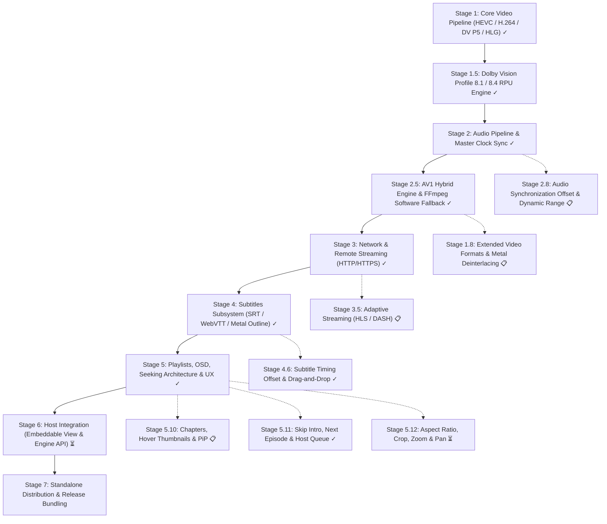

# Nits: Architecture & Roadmap

This document outlines the architecture, current implementation status, and development roadmap for `Nits`.

The goal is to evolve the Apple Silicon dual-engine video rendering core into a full-featured standalone media player with hardware-accelerated and software decoding, studio-grade synchronized audio, advanced subtitles, network streaming, playlist management, and host integration capabilities (an embeddable video canvas and native engine API that Emby and Jellyfin clients can bridge to their web UIs).

---

## 1. Architectural Baseline & System Invariants

- **Target Platform:** macOS 15.0+ (Sequoia) / Apple Silicon (ARM64).
- **Language Standard:** Swift 6 with complete concurrency checking enabled (`-strict-concurrency=complete`, `ExistentialAny`).
- **Framework Stack:** Metal, QuartzCore (`CADisplayLink`), AVFoundation (`AVSampleBufferAudioRenderer`, `AVSampleBufferRenderSynchronizer`, `AVSampleBufferDisplayLayer`), VideoToolbox, CoreAudio, FFmpeg (`libavformat`, `libavcodec`, `libswresample`, `libdav1d`), Swift Observation (`@Observable`).
- **Modular SPM Decomposition:**
  - `NitsCore`: Headless engine core with zero SwiftUI dependencies (demuxing, decoding, ring buffers, Metal BT.2390 shaders, A/V synchronization, IOKit display sleep assertions, playback history, playlists, subtitle parsing).
  - `NitsKit`: Windowing, lifecycle, and macOS AppKit integration layer (`PlayerWindow`, `PlayerWindowController`, `PlayerCommands`, `NowPlayingController`, `LogViewerWindowController`).
  - `NitsUI`: Pure declarative SwiftUI presentation layer (controls overlay, telemetry HUD, OSD notifications, Metal-outlined subtitles, shared side panel hosting playlist and quick settings, Jump to Time dialog, Open URL sheet).
  - `NitsApp`: Application lifecycle entry point (`NSApplicationDelegate`, LaunchServices document types, CLI arguments parsing).

---

## 2. Implementation Stages Overview

---

## 3. Detailed Stage Breakdown

### Stage 1: Core Video Pipeline & Format Expansion — [COMPLETED] ✓

- [x] **1.1. Reference Dual-Engine Presentation Pipeline:**
  - **Apple Liquid Retina XDR Displays (EDR > 1.01):** Direct hardware overlay via `AVSampleBufferDisplayLayer` unlocking 1000–1600 nits peak highlights.
  - **Standard SDR Displays (EDR == 1.0, e.g., external 4K/5K monitors):** Custom Metal tone-mapping compute shader (ITU-R BT.2390 EETF with its black level lift, 203 nits reference white (Dolby Vision: 100…203 by the scene peak), Display P3 gamut, sRGB-encoded output, AMD FidelityFX CAS 5× luma-optimized sharpening).
  - Dynamic display-adaptive handover between `.auto`, `.system`, and `.metalToneMap` with zero frame stalls or pipeline tear-down.
- [x] **1.2. Hardware HEVC / H.265 Decoding (VideoToolbox):**
  - 10-bit P010 biplanar YCbCr decoding with MSB alignment normalization (`val * 65535.0 / 1023.0`).
  - Header parsing for `hvcC` extradata configuration boxes and raw Annex B NAL byte streams.
- [x] **1.3. H.264 / AVC Support (8-bit & 10-bit SDR):**
  - Parameter set extraction for SPS (NAL 7) and PPS (NAL 8).
  - Decompression session configuration via `CMVideoFormatDescriptionCreateFromH264ParameterSets`.
  - Dynamic pixel format binding (`.r8Unorm` vs. `.r16Unorm`, Video Range vs. Full Range).
  - Direct SDR Metal render pass: BT.709 OETF $\to$ Linear BT.709 $\to$ Display P3 (sRGB-encoded) with FidelityFX CAS bypassing EETF tone-mapping overhead.
- [x] **1.4. Extended HDR Standards (HLG & Dolby Vision Profile 5):**
  - HLG (Hybrid Log-Gamma, BT.2100 / ARIB STD-B67): Inverse OETF and display-adapted OOTF gamma scaling.
  - Dolby Vision Profile 5: Extradata inspection for `dvvC`/`dvcC` boxes, IPTc2 / ICtCp matrix unpacking $\to$ LMS' $\to$ ST 2084 PQ EOTF $\to$ Linear BT.2020 in nits, eliminating green/purple tinting.
- [x] **1.5. Non-Square Pixel Aspect Ratio (SAR / DAR) Support:**
  - Dynamic extraction of `sample_aspect_ratio` from FFmpeg `AVCodecParameters` and `AVStream`.
  - Exact aspect ratio geometry calculation via `RationalAspectRatio`.
  - Automatic anamorphic frame correction across video presentation surfaces and subtitle overlays.

---

### Stage 1.5: Dynamic HDR & Dolby Vision Profile 8 (8.1 / 8.4) Engine — [COMPLETED] ✓

- [x] **1.5.1. Profile Detection & Hardware Configuration:**
  - Parse `dvvC`/`dvcC` configuration boxes from container extradata and packet side data (`AV_PKT_DATA_DOVI_CONF`).
  - Distinguish Profile 5 (ICtCp), Profile 8.1 (HDR10 PQ base layer), Profile 8.2 (SDR BT.709), Profile 8.4 (HLG), and Profile 7 (MEL/FEL).
  - Construct Apple-compliant `CMVideoFormatDescription` with `kCMVideoCodecType_DolbyVisionHEVC` (`dvh1`), enabling hardware VideoToolbox decoding with attached `DolbyVisionRPUData`.
- [x] **1.5.2. DOVI RPU Bitstream Parsing (Level 1 & Level 2 Dynamic Metadata):**
  - Parse Dolby Vision Level 1 (L1) dynamic metadata from RPU payload (NAL unit 62): frame-accurate `min_pq`, `max_pq`, and `avg_pq` with ST 2084 nits conversion.
  - Parse Dolby Vision Level 2 (L2) display trim passes for 100-nit SDR mastering targets (`target_max_pq ≈ 2081`), extracting normalized slope, offset, power, and saturation gain parameters per SMPTE ST 2094-10 / ETSI TS 103 572.
  - High-performance, zero-allocation bitstream parser with emulation prevention unescaping (`0x000003`) and boundary validation for 4K60 streams.
- [x] **1.5.3. Scene-Adaptive Tone Mapping:**
  - Forward dynamic L1/L2 metadata with frame PTS through `VTVideoDecoder` into `FrameQueue` and `CADisplayLink` rendering passes.
  - BT.2390 driven by dynamic shot peak luminance and adaptive white point scaling via L1 with exponential moving average (EMA) temporal smoothing and scene-cut resets.
  - Opt-in (off by default, as in mpv; Settings, Quick Settings, `--dovi-trims`): authored 100-nit L2 trim SOP (Slope, Offset, Power) applied on top of the BT.2390 output to the max-RGB intensity (hue-preserving), in PQ normalized to the trim's target display. An approximation: Dolby's own base display-management curve is not public. Neutral trims are skipped; frames without RPU hold the last L1-smoothed peak and target.
  - Telemetry reporting in Performance HUD (`Metal SDR (DoVi L1 + L2 Trim)` / `Metal SDR (DoVi L1)`).
- [x] **1.5.4. User Target White Point Calibration:**
  - User-configurable `targetNitsScale` multiplier (0.5×–2.0× in UI, 0.1×–4.0× engine bounds) to fine-tune the SDR reference luminance for ambient room lighting.

---

### Stage 2: Audio Pipeline, Hardware Master Clock & System Integration — [COMPLETED] ✓

- [x] **2.1. Hardware Master Clock Synchronization (A/V Sync):**
  - Unified playback clock driven by `AVSampleBufferRenderSynchronizer` with `AVSampleBufferAudioRenderer`.
  - CoreAudio hardware timebase anchors media timing; video presentation is paced against the synchronizer clock, eliminating lip-sync drift.
  - Clock settling guard (`ClockSettlingGuard`): transient hardware clock stabilization on seek and track changes, preventing burst frame drops in `FrameQueue`.
- [x] **2.2. Audio Demuxing & Decoding (FFmpeg libavcodec + libswresample):**
  - Concurrent packet extraction via background `audioQueue`.
  - Multi-threaded decoding and resampling to 48kHz 32-bit Float Linear PCM wrapped into `CMSampleBuffer` via `FFAudioDecoder`.
  - Apple Spatial Audio and multichannel surround (5.1 / 7.1) support via standard CoreAudio tags (`kAudioChannelLayoutTag_AudioUnit_5_1`, `kAudioChannelLayoutTag_AudioUnit_7_1`).
  - Planar buffer access via `extended_data` in `swr_convert` (guaranteeing crash-free operation with $>8$ audio channels).
  - Dynamic on-the-fly resampler recreation upon stream sample rate, channel count, or layout alterations.
- [x] **2.3. Queue Management & Live Track Switching:**
  - Non-blocking `audioFeedQueue` feeding `AVSampleBufferAudioRenderer.requestMediaDataWhenReady` with ~0.3s lead time.
  - Native backpressure handling: elimination of CPU busy-spin loops by adhering to CoreAudio buffer readiness.
  - Dynamic audio track discovery (`audioTracks`) and seamless hot-switching (`selectAudioTrack(id:)`).
  - Linear volume control (`0.0 ... 1.0`), mute toggling (`isMuted`), and volume level feedback in OSD.
- [x] **2.4. CoreAudio Route Monitoring:**
  - Real-time default audio output device monitoring via `CoreAudioOutputRoute` (`kAudioHardwarePropertyDefaultOutputDevice`).
  - Automatic audio rendering pipeline migration when connecting/disconnecting AirPods or external DACs.
- [x] **2.5. Audio-Only Playback Mode:**
  - Native playback for standalone audio containers and lossless formats (FLAC, MP3, AAC, OGG, Opus, WAV, ALAC, AIFF, APE).
  - Dedicated audio player UI with album artwork display (embedded ID3/Vorbis tags or remote artwork URLs), waveform visualization, and metadata badges.
- [x] **2.6. System Media Controls & Now Playing Integration:**
  - Dual-backend implementation: modern `NowPlaying.framework` (`MediaSession` on macOS 27+) with backwards-compatible `MediaPlayer` (`MPNowPlayingInfoCenter` / `MPRemoteCommandCenter`).
  - Remote command handling: Play, Pause, Toggle, Seek/Scrub, and Skip.
  - Hardware accessory support: macOS Control Center, Menu Bar Now Playing item, hardware keyboard media keys, Touch Bar, and Bluetooth headset controls.
  - Embedded and external artwork extraction and pipeline forwarding.

---

### Stage 2.5: Universal Video Decoding — AV1 & FFmpeg Software Fallback — [COMPLETED] ✓

- [x] **2.5.1. Decoder Protocol Abstraction (`VideoDecoderProtocol`):**
  - Unified decoder interface: `decode(sampleBuffer:)`, `flush()`, `drain()`, and `setOutputHandler`.
  - Dynamic backend instantiation via `VideoDecoderFactory`: transparent selection between hardware `VTVideoDecoder` and software FFmpeg decoders.
- [x] **2.5.2. AV1 Hybrid Engine (AOMedia Video 1):**
  - Hardware-accelerated decoding on Apple Silicon M3/M4+ through VideoToolbox (`kCMVideoCodecType_AV1`, OBU parsing, `av1C` atom extraction).
  - High-performance software fallback for M1/M2 chips via `libdav1d` (VideoLAN SIMD/NEON assembly through FFmpeg).
  - Vectorized UV plane interleaving and zero-copy mapping into `CVPixelBufferPool` instances with IOSurface and Metal backing.
- [x] **2.5.3. FFmpeg Software Decoder for Legacy Codecs (WMV / VC-1):**
  - Multi-threaded software decoder `FFmpegVideoDecoder` supporting Windows Media Video (WMV1, WMV2, WMV3) and VC-1 (SMPTE 421M).
  - Conversion of planar YUV420P / YUVJ420P / YUV420P10 frames directly into hardware-backed `CVPixelBuffer`s (NV12 / P010).
  - Generation token tagging (`generation token`) in frame queues, atomically discarding stale pre-seek frames during concurrent decode and flush cycles.
- [x] **2.5.4. Legacy MPEG-4 Family (DivX / Xvid / MS-MPEG4 / H.263):**
  - `FFmpegVideoDecoder` support for MPEG-4 Part 2, Microsoft MPEG-4 v1–3 and H.263 / H.263+ (AVI, 3GP, MKV, MP4).
  - AVI streams without presentation timestamps: packet metadata travels with `AV_CODEC_FLAG_COPY_OPAQUE`, PTS come from the decoder's reordering, and exact-seek preroll is decided on the real frame PTS.
- [x] **2.5.5. MPEG-1 / MPEG-2 (VCD, DVD VOB, MPEG-PS, MPEG-TS / M2TS):**
  - `FFmpegVideoDecoder` support for MPEG-1 and MPEG-2 video (4:2:0); anamorphic DVD aspect ratios from the sequence header.
  - Index-less containers (MPEG-TS / MPEG-PS): seeks sync to the next video keyframe, backing off until it precedes an exact-seek target.
  - MPEG-TS / MPEG-PS timestamps are rebased onto a zero-based timeline (`start_time`), including subtitles and thumbnails.
  - Untagged streams get BT.601 colorimetry at SD resolutions (SMPTE C / EBU primaries by line count) and BT.709 at HD.
  - Interlaced content is deinterlaced by 1.8.3.
- [x] **2.5.6. Flash & Early Web Video (Sorenson Spark, VP6, VP8, Theora):**
  - `FFmpegVideoDecoder` support for Sorenson Spark (FLV1) and On2 VP6 / VP6F / VP6A (alpha dropped) in FLV, VP8 in WebM / Matroska, and Theora in Ogg.
  - `FFmpegVideoDecoder` uses slice threading only: frame threading delays output past the few packets seek previews and frame steps decode.
  - VP6 and Theora have no FFmpeg encoder, so they lack synthetic test media.
- [x] **2.5.7. RealMedia (RealVideo 1–4, RealAudio):**
  - `FFmpegVideoDecoder` support for RealVideo 1.0–4.0 in `.rm` / `.rmvb`; RealAudio (14.4K, G2 Cook, SIPR, ATRAC3) through `FFAudioDecoder`.
  - RealVideo 3/4 (`.rmvb`) and Cook have no FFmpeg encoder, so they lack synthetic test media.
- [x] **2.5.8. Any FFmpeg-Decodable Video (libswscale fallback):**
  - `VideoCodec.software(ffmpegCodecID:)` covers every video codec FFmpeg can decode without a dedicated case (Motion JPEG, DV, Cinepak, QuickTime Animation, Indeo, HuffYUV, ProRes, DNxHD…); the stream info panel shows FFmpeg's codec name.
  - `FrameFormatNormalizer` converts frames that aren't planar 4:2:0 (4:2:2, 4:4:4, 4:1:1, RGB, palette, gray) with libswscale to 8- or 10-bit 4:2:0; RGB is encoded and tagged BT.601 at SD, BT.709 above.
  - `StreamColorimetry` accepts only real CoreVideo constants from `CV*GetStringForIntegerCodePoint`: its placeholders (e.g. "YCbCrMatrix#5" for BT.470BG / PAL BT.601) fall back to the FFmpeg mapping.

---

### Stage 1.8: Extended Video Formats & Compute Deinterlacing — [PLANNED]

> Broaden codec compatibility for web rips and broadcast media while eliminating interlacing combing artifacts.

- [x] **1.8.1. VP9 Codec Integration (WebM / YouTube Streams):**
  - VideoToolbox hardware decode path for VP9 Profile 0 (8-bit) and Profile 2 (10-bit HDR) where supported.
  - Software decoding fallback via `FFmpegVideoDecoder` (`libvpx-vp9` / native FFmpeg VP9).
  - Mapping of WebM container metadata (Color config, mastering display metadata, MaxCLL/FALL).
- [ ] **1.8.2. Professional Production Codecs (Apple ProRes & Avid DNxHR):**
  - Native hardware/framework VideoToolbox decoding for Apple ProRes family (`kCMVideoCodecType_AppleProRes422`, `ProRes422HQ`, `ProRes422LT`, `ProRes422Proxy`, `ProRes4444`, `ProRes4444XQ`).
  - FFmpeg software decoding for Avid DNxHD / DNxHR with high-bitdepth P010/NV12 pool allocation.
  - Until then ProRes and DNxHD play through `FFmpegVideoDecoder` (2.5.8), with chroma reduced to 4:2:0.
- [x] **1.8.3. Metal Compute Deinterlacing:**
  - Interlaced frames (`AV_FRAME_FLAG_INTERLACED` / `TOP_FIELD_FIRST`) are deinterlaced in `FFmpegVideoDecoder` by `MetalDeinterlacer` (`Deinterlace.metal`) before they reach the frame queue, seek preview or step cache: one progressive frame per interlaced frame, keeping the first field, weaving the second where it fits between its neighbours and interpolating along edges where it combs. No frame history, so no added latency.
  - Interlaced H.264 (1080i broadcast, AVCHD) is decoded by FFmpeg: Apple Silicon's VideoToolbox rejects field-coded H.264 (`kVTVideoDecoderBadDataErr`). `FFmpegVideoDecoder` takes the `avcC` / `hvcC` from the format description because samples arrive length-prefixed.
  - MPEG-TS / MPEG-PS rewind to byte 0 after probing: the timestamp rewind landed past the first packet and lost the opening keyframe (H.264 dropped its whole first GOP).
- [x] **1.8.4. Field-Rate Deinterlacing (50 / 60 fps output):**
  - Streams declared interlaced (`field_order`, or standard-definition DV, interlaced by format) get a progressive frame per field: `MetalDeinterlacer` runs `deinterlacePlane` once per field in one command buffer, the second frame presenting a field later (`FieldTiming`, honouring `repeat_pict`). Each frame still comes from its own interlaced frame, so there is no latency or frame history and seek previews and frame steps work as before. Frames flagged interlaced in streams that don't declare it keep one frame per frame.
  - The engine paces such streams at the field rate (`outputsFieldRate`): display-link rate, frame-queue lead window, exact-seek floor and frame steps (a field per step).
  - Exact seeks can land on a second field: the demuxer attaches the seek target to every preroll sample and `FFmpegVideoDecoder` decides visibility per field.
  - Motion is confirmed against the previous frame (causal, so still no latency): a line that looks combed but hasn't changed since that frame is woven, so fine still detail (thin horizontal lines) no longer flickers between the two fields' frames. The history is one source frame, dropped on flush and ignored unless the next frame follows it directly.
  - Fields that show the same moment (film in 50i / 60i, PsF, DV shot progressive, still scenes) stay one frame for the whole interlaced frame, so frame steps don't stall on repeats. The shader counts moving samples whose rows alternate over three lines between the fields and within one field; fields differ only when the first clearly outnumbers the second, which moving texture and noise produce alike.
  - The Video pane of Quick Settings offers the mode for interlaced content: Auto (frame per field), Frame per Frame, Off. Switching re-seeks to the current frame; the choice lasts the session.

---

### Stage 2.8: Audio Synchronization Offset & Dynamic Range Management — [PLANNED]

> Solve wireless audio latency and improve dialogue intelligibility during wide dynamic range film playback.

- [x] **2.8.1. Manual Audio Synchronization Delay (A/V Sync Offset):**
  - Audio timestamp offset (`PlayerEngine.audioDelay`, `-1.0 ... +1.0` s) applied by `DelayedAudioSink` to the
    timestamps the renderer schedules; the clock, picture and subtitles stay on the media timeline. Seeks read audio
    from the target minus the delay; with audio played late, the demuxer also reads the audio stored before the
    landed keyframe (`readAudioAhead`), which plain reading from the keyframe skips. Compensates badly muxed files and external DSP (AV receivers); macOS already
    accounts for the reported latency of Bluetooth routes.
  - Runtime adjustment without a seek: the renderer is flushed and the audio it held is enqueued again with the new
    shift. Manual entry in Quick Settings (`Audio` pane, milliseconds).
  - Keyboard shortcuts (`J` / `K`, as in VLC; `F` is fullscreen) adjusting delay in ±50ms steps with OSD feedback.
  - Remembered per file in `PlaybackHistoryStore`, like the subtitle delay.
- [ ] **2.8.2. Dynamic Range Compression & Night Mode:**
  - Audio processing filter stage in `FFAudioDecoder` or CoreAudio AudioUnit graph.
  - Night Mode / Voice Boost: dynamic range compression raising low-level dialogue while softly limiting explosive peaks and loud effects.

---

### Stage 3: Remote Network & Stream Playback (HTTP/HTTPS) — [COMPLETED] ✓

- [x] **3.1. Remote URLs & Custom HTTP Authorization:**
  - Demuxer initialization with custom parameters: `MediaDemuxer.init(url:headers:interruptContext:)`.
  - Pass custom HTTP request headers to FFmpeg via `AVDictionary` (CRLF-formatted strings: `Authorization: Bearer ...`, `X-Emby-Token`, `User-Agent`).
  - Resilient network options: automatic reconnection (`reconnect`, `reconnect_streamed`, `reconnect_delay_max`) and 10s microsecond I/O timeouts (`timeout`, `rw_timeout`).
  - Unified protocol handling for `http://`, `https://`, and `file://` schemes.
- [x] **3.2. Asynchronous Buffering, Interruption & UI:**
  - Non-blocking asynchronous loading via `loadAsync(path:headers:)`.
  - Immediate network cancellation via `AVIOInterruptCB` (`InterruptContext`) on window close or media switch without thread hangs.
  - Playback loading state tracking (`isLoading`) and error presentation with dedicated banners.
  - "Open URL…" modal sheet with preset authentication headers and `⌘U` shortcut.
  - Command-line argument parsing for `--header="Key: Value"` in `PlayerConfiguration`.
- [ ] **3.3. Fast Stream Start:**
  - Measure `avformat_open_input` / `avformat_find_stream_info` time on live MPEG-TS / IPTV sources; probing currently runs with FFmpeg defaults (`probesize` 5 MB, `analyzeduration` 5 s).
  - Tune `probesize` / `analyzeduration` for network streams without missing late-appearing audio streams (e.g. AC-3 in TS).

---

### Stage 3.5: Adaptive Bitrate Streaming (HLS & MPEG-DASH) — [PLANNED]

> Support modern adaptive web media streams with multi-rendition quality switching.

- [ ] **3.5.1. HTTP Live Streaming (HLS) Multi-Rendition Demuxing:**
  Built on FFmpeg's HLS demuxer, which parses master playlists and exposes each variant as an `AVProgram` (its
  `BANDWIDTH` as `variant_bitrate`). A client of our own (as VLC's and GStreamer's) is left for DASH / LL-HLS.
  - [x] Variant selection: `MediaDemuxer.variants`, the highest bandwidth played, the other variants' streams
    discarded (`AVDISCARD_ALL`) so their segments aren't downloaded; their audio no longer lists as extra tracks.
    Rewinding to the start works on HLS (no byte seeks): the first third of a second was lost.
  - [x] Manual variant picker (Quality in Quick Settings' video pane, `PlayerEngine.selectVariant(id:)`). The switch
    is spliced without a seek (`MediaDemuxer+Variants.swift`): the new variant is enabled beside the old one (FFmpeg
    catches it up with `AVSEEK_FLAG_ANY`, mid-GOP), its pictures are dropped up to its first keyframe at T, the old
    variant's from T on; audio takes over when the old one reaches T, and the old variant is discarded. Queued packets
    keep the format description they were read with; VideoToolbox waits for the old format's frames before its new
    session. A local HLS manifest now plays (it was parsed as a track playlist and opened nothing).
  - [ ] Variants with another video codec, colour or audio (`isSwitchable == false`, not offered yet): switch them
    with new decoders, through a seek to the current frame as an audio track switch does.
  - [x] Network read-ahead (prerequisite for adaptive bitrate): a demuxer thread reads network sources up to 30 s /
    192 MB ahead, as mpv's demuxer cache; feeders take packets without waiting for the network. Without it playback
    had about a second and a half of margin, and downloads could not be measured (FFmpeg reads segments only inside
    `av_read_frame`, which waited on the feeders).
  - [x] Adaptive bitrate ("Auto" in Quality, the default for network sources with variants): throughput measured
    by the read-ahead thread from the bytes that came over the network (`FFmpegIOByteCounter`, through FFmpeg's own
    `io_open`), the lower of two exponential averages weighed by the media read, combined with the read-ahead level;
    a new connection's latency measured apart, as its share of the media; HLS segment prefetch off, connections kept
    open but for live. See "Network read-ahead" in `docs/ARCHITECTURE.md`. Tested against `TestHTTPServer` with a
    throttled link.
  - [ ] Check adaptive bitrate by hand on real networks (Network Link Conditioner, a real HLS ladder, Emby), VOD
    and live; and the Quality picker in the app bundle (UI is judged from the bundle only). Streams that worked on
    2026-10-22: 3cat Canal 324, live, 0.85–4 Mbit/s
    (`https://directes-tv-int.3catdirectes.cat/live-origin/canal324-hls/master.m3u8`); Mux, VOD, 0.25–6 Mbit/s
    (`https://test-streams.mux.dev/x36xhzz/x36xhzz.m3u8`); Apple's examples under
    `https://devstreaming-cdn.apple.com/videos/streaming/examples/` (`av1-sample/av1-sample.m3u8`,
    `adv_dv_atmos/main.m3u8`, `bipbop_adv_example_hevc/master.m3u8`), big ladders, slow to open (below). On Emby,
    check the opening's prefetch too (`HLSPlaylistPrefetcher`): it sends the source's headers through URLSession,
    and cookies a master's answer sets stay its own; `TestHTTPServer` checks neither.
  - [ ] Live streams keep connections too: a connection per segment takes a handshake and TCP's slow start a
    request, which at 180 ms of round trip took half a second per second of media for VOD (`docs/ARCHITECTURE.md`).
    Live opens one per segment for the read-ahead thread to tell the wait at the edge by `io_open`; it needs another
    sign of that wait.
  - [x] An audio description (`public.accessibility.describes-video`, `AV_DISPOSITION_VISUAL_IMPAIRED`) isn't
    chosen on load before a plain track in its language: Apple's AV1 example lists it first, and FFmpeg flags both
    streams default (the fragmented MP4's flag joins the rendition's). Renditions are named by their `NAME`, which
    FFmpeg puts in the stream's comment ("English (DVS)", "Italiano (SDH)"; they showed no name).
  - [ ] A variant's own subtitle stream (not a rendition) is lost on a switch: subtitles aren't moved to the new
    variant's stream at the same position, as audio is.
  - [ ] A splice rewrites the stream description on the reading thread, fields `canSwitch` keeps equal (`codec`,
    colour) too, while `replaceStalledDecoder` reads `demuxer.codec` without a lock: the same value, still a race.
  - [ ] Full `swift test` runs fail one real-time test each now and then, a different one every time (the libass
    watch, deinterlaced frame steps, an exact VP9 seek: a `waitUntil { engine.isPlaying }` timing out), all passing
    alone. Seen since the network suites (`AdaptiveBitrateTests`, `HLSOverHTTPTests`, `HLSRenditionTests`) came in:
    find what loads the host, or keep those suites apart from real-time ones.
  - [x] Audio and subtitle renditions (`EXT-X-MEDIA`): only the selected ones are read (`applyStreamSelection`),
    applied by the reading thread at its next read or seek; FFmpeg discarded every subtitle rendition itself, so HLS
    subtitles never showed before. Selecting one on a network source seeks to the current frame. Variants must
    share their subtitle renditions to switch (a variant's own subtitle stream goes with its video).
  - [x] AV1 / VP9 variants switch: their description comes from the new variant's `av1C` / `vpcC` (the splice asked
    for H.264 parameter sets and gave every switch up).
  - [ ] Thumbnails and seek previews of HLS read the lowest variant only.
  - [x] **Faster opening of big ladders.** FFmpeg's HLS demuxer reads every playlist of a master and probes every
    video and audio one (init section and first segment), a request after another: Apple's examples, a program per
    tier and audio group (54–99 programs), took 47 s (bipbop advanced), 58 s (AV1) and 142 s (Dolby Vision / Atmos)
    to open on 2026-10-22; small ladders (3cat, Mux) 1.5–3 s. `HLSPlaylistPrefetcher` downloads all of it side by
    side and FFmpeg reads it from memory: the AV1 example opened in 3.9 s on a cold CDN cache instead of 54.5, and
    in 0.7 s on a warm one instead of 12; Dolby Vision / Atmos in 8.3 s and 1.2 s instead of 142; bipbop advanced
    in 5–6 s instead of 47 (see "HLS opening" in `docs/ARCHITECTURE.md`).
  - [x] The playlists of variants that can't switch with the one played, and of renditions only they refer to, are
    refused to FFmpeg while it opens: Dolby Vision / Atmos opened in 2.7 s and 0.6 s, bipbop advanced in 3.5 s and
    1.8 s (the ladder is the highest variant's, as before).
  - [ ] Playback starts on the highest variant. Starting lower (the first listed, as Apple advises, or by a first
    measurement) waits for an earlier splice of a step up: one comes at the read position, 20–30 s ahead, so a
    start low on a fast link would play low for that long. Opening still reads 0.2–3 MB of each video variant's
    first fragment where fragments are whole 8 s segments (bipbop advanced): find out which call reads that far.
  - [ ] Adaptive bitrate at playback rates above 1x: a variant then needs its bandwidth times the rate.
  - [ ] Seeks and track switches on a live stream wait for the read-ahead thread, asleep in `av_read_frame` until
    the playlist has a new segment (up to a segment's duration). Interrupting that wait makes FFmpeg fail the
    segment read (`AVERROR_EXIT`): find out first whether the playlist recovers from it.
- [ ] **3.5.2. MPEG-DASH Integration:**
  - Parsing `.mpd` manifests and segmented MP4/WebM initialization fragments.
  - The bundled FFmpeg has no DASH demuxer: it needs `--enable-libxml2` (`scripts/build_dependencies.sh`, bump
    `DEPS_VERSION`); a Homebrew FFmpeg may have it, so `swift run` and the bundle can differ. FFmpeg's DASH demuxer
    has no adaptive bitrate of its own either.

---

### Stage 4: Subtitles Subsystem (SRT, WebVTT & Metal Outlines) — [COMPLETED] ✓

- [x] **4.1. Text-Based Subtitle Parsers (SRT, WebVTT):**
  - Robust parser for standard SubRip (`.srt`) and WebVTT (`.vtt`) files.
  - Stripping of HTML formatting tags (`<b>`, `<i>`, `<u>`, ``) while maintaining cue timing.
  - Chronological cue indexing with $O(\log N)$ binary search lookup supporting simultaneous and overlapping dialogue lines.
- [x] **4.2. Embedded Subtitle Demuxing:**
  - Traversal and extraction of subtitle streams (`AVMEDIA_TYPE_SUBTITLE`) from MKV and MP4 containers (`subrip`, `webvtt`, `mov_text`).
  - Metadata parsing: language codes, titles, `isForced`, and `isSDH` flags (from the stream's disposition, or from
    its title when it has none).
  - [x] MicroDVD and SubViewer (`.sub` with no `.idx`) and SAMI (`.smi`, `.sami`) files, read by FFmpeg
    (`FFmpegTextSubtitles`: its demuxers, and decoders that turn each format into ASS events) into plain-text cues
    drawn in the subtitle style, as SRT's are. When the file is added only its beginning is read, and FFmpeg's probes
    must recognize one of these formats by its content, not just the extension (`isReadable`, `format(of:path:)`; SAMI
    their probe misses for its case is told by its tags): binary files (VobSub data without its index) and other text
    make no track, and neither does a file whose demuxer finds no line in it. The rest is read in the background when
    the track is selected: the whole file decoded in its encoding (`TextFileEncoding`) and handed to FFmpeg as a
    UTF-8 copy, as most of these demuxers look for ASCII and the decoders drop lines that aren't UTF-8; by the subtitle
    demuxers only (`format_whitelist`, `file` protocol), so a file found next to the media can't open as a playlist. A
    MicroDVD file that doesn't give its frame rate counts frames at the video's. Cues last at least half a second, as
    embedded tracks' do, but no longer than until the next one, so lines a few frames long don't overlap. Matroska's
    plain `S_TEXT/ASCII` (`text`) streams are listed as text tracks.
  - [x] Encoding of text subtitle files and playlists (`TextFileEncoding`), in mpv's order: byte order mark, valid
    UTF-8, the encoding chosen in Settings → Languages, Foundation's detector (`NSString.stringEncoding(for:…)`, no
    lossy guesses, on the first 64 KB), then Windows-1251 / 1252 / Latin-1. The detector knows letters by their lower
    case: Cyrillic in capitals (forced subtitles) or a single line of it it takes for ISO Latin 2, Thai, Hebrew, GB
    18030 or Latin-1. So its CJK guesses are taken unless the text reads as Windows-1251 with no odd word, no capital
    after a small letter and no sign Cyrillic doesn't use (`readsAsCyrillic`: `北京` is `±±ѕ©`), and Shift JIS not when
    it reads as half-width katakana (`£` in 1252); the Hebrew, Arabic and Thai code pages only with the language in
    the file's name (`film.he.srt`), and a cased
    script's code page (an ISO Latin guess as the Windows one reading it the same: ISO Latin 7 is 1257) competes with
    Windows-1251 and 1252: the reading with fewer odd words wins (`oddWords`: a sign inside a word, Latin mixed with
    Cyrillic or Greek, a Latin word with no ASCII letter; Vietnamese tones, combining marks in 1258, count as letters).
    The file's name is the detector's only language hint: a wrong one misleads it (Windows-1251 Ukrainian said to be
    English comes out Latin-1). NaturalLanguage's recognizer can't judge the readings (it takes garbled Cyrillic for
    Russian or Greek), and uchardet, measured on the same samples, is worse at short and capital Cyrillic, short Polish
    and Czech and CJK, better only at Hebrew, Arabic and Thai without a language in the name. Left wrong: Polish and
    Greek in capitals, those three without the language, a lone `£5` (reads as `Ј5`), KOI8-R (taken for ISO 8859-5;
    the setting reads it), a file whose only letters outside ASCII are `Ні` in Windows-1251 (valid UTF-8: `ͳ`), and a
    single short CJK line that reads as Cyrillic letters alone (`병원` is `єґїш`).
  - [x] CEA-608 closed captions: ATSC `cc_data` in H.264 / HEVC SEI and MPEG-2 user data (US broadcast, HLS) read from
    the video packets (`ClosedCaptions`), listed as CC1 / CC3 tracks when the first pictures carry them, and MP4 `c608`
    tracks; decoded by FFmpeg's `cc_dec` in real-time mode into screens drawn as text in the user's style, put back
    into presentation order first (`ClosedCaptionDecoder`). Within a field, CC2 / CC4 aren't told apart (`cc_dec`).
  - [ ] CEA-708 caption services (windows, pens, several services): FFmpeg has no decoder; needs one of our own from
    CTA-708. Most content also carries the 608 bytes, which are read.
  - [ ] Captions that start after the first pictures read while opening get no track; tracks could also be added
    when playback first meets them, as mpv does.
  - [ ] Subtitle codecs not listed as tracks yet: DVB Teletext, TTML / IMSC (MP4, DASH).
- [x] **4.3. Dynamic Positioning & ASS/SSA Tags:**
  - Parsing of ASS/SSA alignment tags (`{\an1}` – `{\an9}`).
  - Dynamic positioning in `SubtitleOverlayView`: top-aligned cues render at the top of the display surface without colliding with bottom subtitles.
- [x] **4.4. GPU-Accelerated Outline Shader & Styling (Metal + SwiftUI):**
  - Custom stitchable Metal shader (`SubtitleOutlineModifier` / `SubtitleShaders.metal`) generating crisp, omnidirectional text outlines without blur artifacts.
  - Proportional font scaling dynamically adapting text sizes to video dimensions.
  - Comprehensive styling settings: font family, weight, point size (16–54 pt), text color, background box color, and opacity with live interactive previews.
  - Persistence across sessions via `UserDefaults`.
- [x] **4.5. Advanced ASS/SSA Typesetting & Bitmap Subtitles:**
  - [x] ASS / SSA drawn by libass (`AssSubtitleRenderer`): styles, positioning, animations, karaoke, vector drawings and
    the fonts a Matroska file attaches; fonts come from Core Text. Embedded tracks keep their header and events
    (`AssScript`) next to the plain-text cues, `.ass` / `.ssa` files load whole. libass draws at the pixel size of
    the visible picture (`SubtitleController.renderSize`, reported by `SubtitleOverlayView`), off the main thread, one render at
    a time. Until that size is known, and with "Original ASS Styling" off (`usesAuthoredStyles`), the text
    cues are drawn in the user's subtitle style as before. Hosts get the plain text and `rawPayload` either way.
    A frame is a picture per group of images near each other (a sign at the top and the dialogue at the bottom make
    two), not one the size of the frame; pictures show and go without the text's fade.
  - [x] Animations are drawn at the video's frame rate: while libass reports a changed picture (fades, moves,
    karaoke), the next render comes a frame later from the synchronizer clock rather than at the 20 Hz time tick;
    the first unchanged render ends it (`scheduleAuthoredAnimationFrame`).
  - [x] Style override ("Dialogue in My Style", `assStyleOverride`, remembered): As Authored, Font and Size, or Font,
    Size and Colors from the subtitle style, through libass' selective override (`ass_set_selective_style_override`),
    which leaves positioned text (signs) alone. The system's rounded, serif and monospaced designs, which Core Text
    hides from libass, are handed to it as files. The style's weight isn't applied (it would take the script's
    italics with it).
  - [x] The pixel aspect given to libass is the one the picture is shown with: a forced display aspect ratio
    stretches the video's pixels (`VideoGeometry.frameAspectRatio`), a crop doesn't; changing it redraws.
  - [x] Bitmap subtitle overlays: PGS (Blu-ray `hdmv_pgs_subtitle`), VobSub (DVD) and DVB, decoded by `BitmapSubtitleDecoder`
    (`avcodec_decode_subtitle2`) into `SubtitleImageCue`s that keep palette indices, not pixels, and are drawn by
    `SubtitleOverlayView` over the visible picture. A canvas of other proportions than the picture (a 16:9 PGS on a rip
    with the bars cut off) is fitted whole with one scale on both axes. A set ends at its duration or, as PGS gives none, at the set that clears or replaces it,
    however late (5 s for the last). Palette indices of a whole film take tens of MB (about 10 KB a set on a sample,
    more with full-width captions); storing RLE and expanding on demand is left for later.
  - [x] External `.sup` (PGS) and `.idx` (VobSub, one track per language; a dropped or picked `.sub` loads through its
    `.idx`, one with none is refused), also found next to the media; their pictures are read when the track is
    selected.
  - [x] Embedded tracks (text, ASS, pictures) come from the packets playback reads, for local files as for network
    ones, as in mpv and VLC; a whole-file read (every byte of a Matroska file) made a track on a network volume show
    nothing for minutes. What playback can't give comes from a window read (mpv's refresh seek and subtitle preroll):
    from 10 s before the time up to where playback reads from, when a track is chosen or a load or seek lands, and up
    to 10 s ahead, in steps, while a negative subtitle delay shows the track ahead of what playback has read; never
    what the lists hold already. Window reads run below playback's own (`.utility`). Background reads are cancelled, blocking I/O included (`FFmpegInterrupt`), once their
    track is no longer selected or the media stops. A PGS set is only ended by a set read in the same stretch of
    reading (between seeks), as a seek may have skipped the one that really ended it.
  - [x] A track chosen later has at once what playback read of it, network sources included, as mpv's demuxer cache
    serves its refresh seek: the packets of every subtitle stream are kept as they pass (`SubtitlePacketStash`), by
    stretch of reading (a seek starts another), and decoded in the background when the track is chosen; a window read
    covers only what they don't. Picture streams share 64 MB, the oldest packets dropped first; closed captions in the
    video's pictures aren't kept.
  - [ ] One secondary demuxer opened and probed per window read; keeping one per media, and following sound rather
    than pictures in MPEG-TS (cheaper to parse), wait for a measurement of seeks on a network volume.
  - [x] A window the file's own index shows to hold no packet of the track isn't read, and a read starts at the first
    packet it lists, as mpv's subtitle preroll does with Matroska Cues. The index is read once per media
    (`EmbeddedSubtitleReader.readIndex`) by a demuxer that discards every stream from the header on, so it holds only
    the Cues (parsed at a seek) or the MP4 sample table: the playback demuxer's mixes in the blocks it reads, its
    probing's too, and FFmpeg doesn't expose `CueDuration`, which mpv tells complete Cues by. A Matroska stream the
    Cues list nothing of counts as unindexed (muxers list every subtitle block, or none). Only Matroska and MP4:
    elsewhere FFmpeg indexes what its own seeks read (the MPEG-TS timestamp search). A Matroska file whose pictures
    have a single Cues entry makes the seek that parses the Cues read on to the end (`matroska_read_seek`). An index
    whose picture (or sound) entries stop more than 10 s before the end is none (`indexEndMargin`): FFmpeg lists a
    fragmented MP4 with a complete `sidx`, or one it can't seek in, only as it reads the fragments. Not checked on such
    a file.
  - [x] The secondary demuxer of a window read doesn't probe Matroska and MP4 (`avformat_find_stream_info` reads the
    first clusters; their header describes every stream), and seeks by the picture stream to the first packet the
    index lists: a seek by the subtitle stream to its last Cues entry would make FFmpeg parse clusters to the end of
    the file, looking for a later one (`matroska_read_seek`).
  - [x] Network sources get a window read only where the file's index tells where the track's packets are (Matroska
    Cues, an MP4 sample table), read once per media, from the first packet it lists, up to 32 MB with the header and
    index (`networkWindowByteLimit`, 3 s of an 80 Mbit/s remux): a whole window reads every stream for seconds, against
    playback refilling after a seek. A window the index lists nothing in costs no request. Elsewhere (MPEG-TS, files
    without subtitle Cues), after a seek, a cue that started before the landing keyframe shows from the next one, as
    in mpv; a track chosen later still has what playback read of it. The index read and the window reads open the URL
    again: a server with a single connection fails the index read, and the media gets no window read; one that drops
    playback's connection for the second would show it as a stall. Not yet checked against a real HTTP server.
  - [x] VobSub checked on a real file (2026-10-20): 27 VobSub tracks of a 2160p MKV on an SMB volume show at once
    after a track switch and after seeks.
  - [x] Bitmap subtitles over HDR video stay at most SDR white (8-bit sRGB pictures, `.allowedDynamicRange(.standard)`).
  - [ ] Checks on real files: PGS from a Blu-ray remux, DVB, and bitmap brightness over HDR video on an XDR display.
  - [x] A crop or zoom set in the player keeps bitmap subtitles at the scale of the picture: the canvas covers the
    whole decoded frame, and regions the crop leaves off screen (dialogue in removed bars) move inside the visible
    part, each half of the frame as a block. Before, the canvas was fitted into the cropped picture and shrank
    (about 1.3× for 2.35:1 on 16:9).
  - [x] Forced-only display ("Forced Subtitles Only", `SubtitleController.showsOnlyForced`, remembered): bitmap tracks show only
    the regions their stream marks forced (`AV_SUBTITLE_FLAG_FORCED`, PGS composition objects and DVD forced
    commands), as Blu-ray discs keep forced sets inside the full track. A track flagged forced as a whole shows in
    full; text tracks mark no events and are left as they are.
  - [x] Automatic track choice on load (`TrackAutoSelection`, after mpv's `select_default_track`), when neither a
    request nor the file's history names a track. Settings → Languages: ordered audio and subtitle languages
    (`alang` / `slang`), forced subtitles in the audio language / never / forced only (`subs-fallback-forced`), and
    what to show when the audio is in a subtitle language: forced only (default), all or none
    (`subs-with-matching-audio`; files next to the media are exempt). Audio: the first listed language, else the track
    flagged default, else the first; choosing the current track keeps it for the file.
    Subtitles: a forced track in the audio language, a track in a listed language, a file next to the media or a
    track flagged default; with no subtitle languages the system's only rank them, so a full track in the user's
    language shows only when flagged default (as in mpv). An automatic choice isn't saved to the history, so later
    settings apply to files already played.
  - [x] Position and scale (mpv's `sub-pos` / `sub-scale`; Quick Settings → Placement, remembered): `SubtitleController.position`
    raises bottom subtitles of every kind, `SubtitleController.scale` sizes ASS dialogue (libass' font scale and line position,
    dialogue only) and picture subtitles (each half of the frame as a block, from the edge it is near); plain text
    keeps its font size.
  - [ ] A second subtitle track shown at once.

---

### Stage 4.6: Subtitle Timing Calibration & Drag-and-Drop Ingestion — [COMPLETED] ✓

> Compensate for out-of-sync subtitle releases and simplify subtitle loading.

- [x] **4.6.1. Subtitle Timing Offset (Subtitle Delay):**
  - Configurable timestamp shift (`SubtitleController.delay`, `-30.0 ... +30.0` s) applied to the cue lookup.
  - Hotkey adjustments (`Z` / `X`) stepping timing by ±100ms with real-time OSD indication.
  - Manual entry field in Quick Settings (`Subtitles` pane).
  - Remembered per file in `PlaybackHistoryStore`, like the track selection; a selected external subtitle file is
    remembered by path (and stream, for the languages of a VobSub index) and loaded again when the media is reopened.
- [x] **4.6.2. Drag-and-Drop Subtitle Attachment:**
  - Dropping a subtitle file (`.srt`, `.vtt`, `.ass`, `.ssa`, `.sup`, `.idx` or a VobSub `.sub`) on the video or the playlist drawer attaches the file to the media playing and selects
    it, with an OSD confirmation (`SubtitleFileDrop`); dropped together with a video, it attaches to that video.
  - `MediaURLResolver` never takes a subtitle file for media, `.ass` / `.ssa` / `.sub` / `.idx` / `.sup` / `.smi` /
    `.sami` included; a `.sub` with no `.idx` loads as MicroDVD or SubViewer text.
- [x] **4.6.3. Sidecar Subtitle Discovery:**
  - `movie.srt`, `movie.en.srt`, `movie.en.forced.vtt` next to a local `movie.mkv` are added as tracks on load
    (`SidecarSubtitles`); language, forced and SDH tags come from the file name.
  - Chosen on load before the media's own tracks, as in mpv (`TrackAutoSelection`): a full file before a forced one.

---

### Stage 5: Playlists, Navigation Architecture, OSD & UX — [COMPLETED] ✓

- [x] **5.1. Playback Speed Control (Variable Rate):**
  - Continuous rate adjustment from 0.5× to 4.0× in 0.1× increments via keyboard shortcuts (`[`, `]`, `\`) and application menus.
  - Instant re-anchoring of `AVSampleBufferRenderSynchronizer` clock avoiding phase distortion or audio buffer underruns.
- [x] **5.2. Responsive Seeking & Scrubbing Architecture:**
  - Keyframe-aligned relative seeking: instant skips jumping directly between keyframes without decoding intermediate P/B frames.
  - Single-frame stepping forward and backward (`,`, `.`, `⌥←`, `⌥→`).
  - Burst-aware relative seeking with chase settle debouncing: preserving play intent and preventing deadlocks during rapid scrubbing.
  - "Jump to Time…" dialog (`⌘J`) for exact timestamp navigation.
  - User-configurable seek step (default 5s) and exact seek mode toggles.
- [x] **5.3. On-Screen Display (OSD):**
  - Animated transient HUD overlay in the top-left corner reporting volume levels, seek offsets with duration progress bars, play/pause states, rate changes, and track switching.
- [x] **5.4. Side Panel & Quick Settings:**
  - Shared non-modal side panel (`SidePanelContainer`, `PlayerSidePanel`) sliding in from the trailing edge: one panel open at a time, the control bars shrink beside it instead of being covered, controls stay clickable, a click on the video or `Esc` closes it. Always dark so it stays legible over bright video.
  - Quick Settings panel with categorized panes: Audio, Video, Subtitles, and Media Info.
  - Direct manipulation of tone-mapping parameters (exposure, shadow lift, target nits multiplier, CAS sharpness).
  - Detailed stream inspector: active video/audio codecs, color primaries, transfer functions, sample rates, channel configurations, and bitrates.
- [x] **5.5. Playlist Management & Directory Scanning:**
  - Reactive `@Observable` playlist engine (`PlaylistManager`).
  - Parsing external playlist formats: M3U, M3U8, PLS, XSPF, CUE.
  - Directory scanning (single folder level) when opening folders, or of the siblings when opening a single media file.
  - Side panel UI: search and filtering, active item indication, auto-scroll to current track, sorting by title, filename or duration with a separate direction toggle. Repeat (Off / All / One) and shuffle live in the control bar (5.9).
  - Persistent playlist repeat and shuffle settings via `UserDefaults`.
  - Non-blocking ingestion: playlist parsing and folder scans run off the main actor with a loading indicator, and path resolution never touches the file system, so playlists of thousands of files on network volumes open in a fraction of a second.
  - Background durations for unplayed items: container-header probe (`MediaDurationProbe`, no decoding, 5 s per-item limit) for local files and LAN media files, persisted in `MediaDurationCache` together with durations learned during playback. The total shows `≈` while some are unknown.
- [x] **5.6. Window Management & Display Sleep Prevention:**
  - `DisplaySleepManager`: IOKit power assertions (`IOKitDisplaySleepAssertion`, `IOPMAssertionCreateWithName`) preventing display sleep and screen savers during active video playback.
  - Cursor autohide (`NSCursor.setHiddenUntilMouseMoves`) and controls overlay fading after 2.5s of user inactivity.
  - Borderless fullscreen mode with double-click toggles and `F` / `⌃⌘F` shortcuts.
  - Low-level layout-independent ANSI keycode handling in `PlayerWindow`.
- [x] **5.7. Playback History, Resume & Recent Media:**
  - Thread-safe storage manager (`PlaybackHistoryStore`) using SHA-256 normalized storage keys.
  - Automatic recording and restoring of media timestamps, audio track selections, and subtitle preferences.
  - Persistent recent media list (`RecentMediaStore`) tracking explicitly opened local files and network streams.
  - Start screen integration (`WelcomeView`): scrollable recent media list with saved progress/timestamps, progress bars, keyboard navigation, and context menus.
  - Application menu integration: native `File → Open Recent` menu with quick clear action, plus Dock menu recent documents via `NSDocumentController`.
  - User-configurable toggle in Settings → General to disable the recent list and clear recorded media independently of resume timestamps.
- [x] **5.8. Logging Architecture & Diagnostics:**
  - Structured, categorized logging via `AppLog` (`.engine`, `.video`, `.audio`, `.demuxer`, `.subtitles`, `.playlist`).
  - In-memory ring buffer log store and live viewer window (`LogViewerWindowController`, `⌥⌘L`).
  - Real-time telemetry in `PlayerPerformanceMonitor` querying Mach kernel task and thread APIs (CPU %, memory footprint, render FPS, frame delivery times).
- [x] **5.9. Modular & Customizable Player Control Bar:**
  - Fully decoupled, atomic control components (`ControlComponents.swift`) rendered dynamically from persistent configuration model (`ControlsConfiguration.swift`, `ControlBarItem.swift`).
  - Reorderable items and visibility toggles: Previous/Next Track, Seek Relative (Backward/Forward), Play/Pause, Timeline & Scrubber, Volume Slider, Audio & Subtitle Track Selectors, Playlist & Quick Settings Drawers, and integrated Playlist Repeat Mode and Shuffle buttons.
  - Dedicated macOS Settings tab ("Controls") with Drag & Drop reordering (`.onMove`) and hide/show actions, synchronized live with active player windows via `@Observable`.
  - Smart auto-hide inhibition: keeps player control bar permanently visible while actively configuring layout in Settings.

---

### Stage 5.10: Chapters, Timeline Thumbnails, Screenshots & Picture-in-Picture — [PLANNED]

> Reference desktop player ergonomics: chapter jumps, visual timeline scrubbing, HDR screenshots, and floating window playback.

- [x] **5.10.1. Container Chapters Navigation:**
  - Demuxing chapter markers (`AVChapter`) from MKV/MP4 containers, normalized into `MediaChapter` (sorted,
    missing ends filled, duplicates such as MP4's Nero `chpl` copy dropped).
  - Chapter gaps on the timeline track; the hover preview shows the chapter title above the thumbnail.
  - Previous/Next Chapter (`⌥⌘←`, `⌥⌘→` / `PageUp`, `PageDown`); "previous" restarts the current chapter
    when more than 5 s into it (mpv's `chapter-seek-threshold`); "next" stops on the last chapter.
  - Chapter list as a tab of the playlist panel (shown only when the media has chapters), `⌥⌘C` / `C` and an
    optional control bar button; side panel headers share one tab bar (`SidePanelTabBar`).
- [x] **5.10.2. Timeline Hover Seek Thumbnails:**
  - Low-priority background worker demuxing and decoding keyframes to generate thumbnail caches.
  - Floating preview popover over the timeline slider displaying frame imagery at the hovered timestamp.
- [ ] **5.10.3. Color-Accurate Screenshot Capture (Frame Export):**
  - [x] Save Screenshot (`⌘S`, Video menu): the frame on screen as the active render mode shows it, with the
    on-screen crop, aspect ratio and zoom, at the source's resolution, to `~/Pictures/Nits` (`FrameCapture`,
    `FrameStillWriter`).
    - `.metalToneMap`: the frame drawn offscreen by the same shader and uniforms, a 16-bit Display P3 PNG of the
      exact 10-bit values the layer shows.
    - `.system`: the frame as the display layer is given it (Core Image reads the buffer's colorimetry): PQ / HLG
      to a 10-bit HEIC in BT.2100, which the viewer maps to its display as the layer does; SDR to a PNG. Dolby
      Vision Profile 5 (IPT-PQ-c2, which the layer composes itself) is composed from its RPU by
      `doviSignalFragmentShader` to the BT.2100 PQ signal, without tone mapping.
  - [ ] Raw mode: the decoded frame without tone mapping or geometry, keeping the stream's colorimetry.
- [x] **5.10.4. Picture-in-Picture (PiP):**
  - Native macOS Picture-in-Picture via public `AVPictureInPictureController` + `ContentSource(sampleBufferDisplayLayer:)`
    (the video-call controller and automatic inline start are iOS-only). Toggle from View menu (`⌃⌘P`) and an
    optional control bar button.
  - Metal tone-mapping mode falls back to `.system` (system tone mapping) while PiP is active; the display link
    moves from the host view to the screen so pacing survives a hidden window.
  - Workarounds for macOS AVKit not laying out the PiP panel (unscaled mirror, stale view, opaque band); smooth
    hand-back onto the video's rect.
  - Window behaviour on enter (hide / keep open; fullscreen and minimized untouched), optional pause on enter, close
    button pauses.
  - Opt-in auto-PiP on window minimize (exit on restore). No auto-PiP on app switch: macOS windows stay visible, so
    it would only steal the video. Leaving the fullscreen Space is not a trigger.

---

### Stage 5.11: Skip Intro, Next Episode & Host Queue — [COMPLETED] ✓

> Streaming-service style buttons over the video for spans of the timeline, and episode navigation driven by the host's
> own queue; the host supplies the spans, the queue and the actions.

- [x] **5.11.1. Host-Provided Spans & Actions:**
  - The host gives buttons for spans of the timeline (`PlaybackActionButton`: id, title, start, optional end) and
    handles presses (`onActionButton(id)`); finding intros and credits (media server markers, chapters, a fallback
    before the end) stays with the host, so Nits is not tied to Emby, Jellyfin or Plex.
  - API: `PlayerWindowController.setActionButtons(_:)` / `openStream(actionButtons:)`, `MediaLoadRequest.actionButtons`;
    engine-only hosts read `PlayerEngine.activeActionButton`. Each load replaces the previous media's buttons at once;
    buttons set right after `openStream` survive the background load.
  - Button in the bottom-trailing corner with a dismiss button beside it. It stays up for a set time of playback
    (Settings → General → Action Buttons, 5–15 s), then shows only with the controls. Optional auto-press with a
    countdown fill (per button opt-out via `allowsAutoPress`). The countdown runs on playback only: it holds on
    pause, scrubbing and frame steps, and restarts after a seek within the span.
  - Dismissing or pressing hides the button for the rest of its span; a new load resets this (`loadGeneration`).
    `Return` presses, `Esc` dismisses (before leaving fullscreen); hovering the button keeps the controls and cursor up.
- [x] **5.11.2. Host-Driven Track Navigation:**
  - A host that keeps its own queue (a media server client's series) sets `onTrackNavigation`; Next / Previous from the
    control bar, the Playback menu (`⌘→` / `⌘←`), media keys and Control Center then call it instead of moving through
    the playlist, and the host answers by loading the item. What the queue has around the current media
    (`TrackNavigation`: `hasNext`, `hasPrevious`, optional titles for the OSD) comes with each load
    (`openStream(trackNavigation:)`, `MediaLoadRequest.trackNavigation`) or later (`setTrackNavigation(_:)`).
  - One press, one request: Next / Previous turn off after calling the host until its next load. Previous keeps the
    playlist rule: past 3 s, or without a previous item, it restarts the media.
  - The end of the media is left to the host (`onPlaybackEnded`): no repeat-one restart, no auto-advance. Repeat-one
    no longer reports an end in any mode.
  - Navigation state lives in the engine (`canPlayNext` / `canPlayPrevious`), so every entry point follows it, and
    the system media controls update on every change, paused too.
- [x] **5.11.3. Controls the Host Doesn't Offer:**
  - `ControlsConfiguration.unavailableItems` (process-wide, not saved): the items leave the control bar and the
    Controls settings whatever the user's saved layout says. Without `.playlist` the side panel shows chapters only,
    and `P` / View → Playlist are off.
- [x] **5.11.4. Up Next Card:**
  - An action button with a `subtitle` or `artworkURL` shows as a card: 16:9 artwork, title and subtitle, a fixed
    width so it keeps its size between episodes. The auto-press countdown runs as a bar along its bottom edge.
    Auto-play at the end of the media stays with the host.

---

### Stage 5.12: Video Geometry — Aspect Ratio, Crop, Zoom & Pan — [IN PROGRESS] ⏳

> How the picture sits in the window: fix a wrongly flagged aspect ratio, cut away burnt-in black bars, fill an
> ultrawide screen, zoom into detail. Presentation only: decoding, frame queue, pacing and A/V sync stay untouched,
> and the default (source aspect, fit) lays the layers out exactly as before.

- [x] **5.12.1. Shared Geometry Model (`VideoGeometry`, NitsCore):**
  - `VideoGeometrySettings` (`Sendable`, `Codable`): aspect override, crop, scaling, zoom, pan. `VideoGeometry.layout`
    maps view size + coded size + SAR + settings to a `VideoLayout` (in the manner of mpv's `mp_get_src_dst_rects`):
    the whole frame's rect, the cropped picture's rect, the visible part clipped to the view, and the normalized part
    of the frame it shows.
  - The only geometry code: `NativeVideoHostView`, `SubtitleOverlayView.computeVideoFrame`, the timeline preview and
    PiP's hand-back rect use it. `PlayerEngine.contentAspectRatio` is the ratio as shown.
- [x] **5.12.2. Aspect Ratio Override:**
  - Default (SAR / DAR from the stream, 1.5) or a forced display ratio for the whole frame: 4:3, 16:9, 16:10, 1.85:1,
    2.21:1, 2.35:1, 2.39:1, 5:4, 1:1 (the VLC / IINA lists). Fixes anamorphic files flagged square and vice versa.
- [x] **5.12.3. Crop:**
  - Crop to a ratio (centered, same list) for letterboxed or pillarboxed masters, e.g. 2.39:1 inside 16:9; applied
    after the aspect override.
- [x] **5.12.4. Scaling Modes:**
  - Fit (letterbox, default), Fill (zoom until the view is covered, edges cut), Stretch (ignore aspect, fill the view),
    Original Size (1 video pixel = 1 backing pixel, larger video is fit).
  - Zoom `0.5×`–`4×` in four steps per doubling; pan per axis in `-1...1` of how far the picture overhangs the view,
    so it never leaves the view and survives resizing. Zoom and pan reset on load.
- [ ] **5.12.5. Presentation on Both Surfaces:**
  - `AVSampleBufferDisplayLayer` sits in a clip layer; with a non-default geometry the clip layer takes the visible
    rect (`masksToBounds`) and the display layer the whole frame's rect with `videoGravity = .resize`, so crop, stretch
    and zoom need no change to the buffers or the selector-based enqueue path. The default keeps the full-bounds
    `.resizeAspect` layer without clipping.
  - Metal: the drawable covers only the visible rect (never larger than the view); the vertex shader maps texture
    coordinates through the source rect (`MetalVideoRenderer.sourceRect`, vertex buffer 0), so `ToneMapUniforms` and
    CAS are unchanged. A source rect change redraws the last frame while paused.
  - Subtitles stay inside the visible part of the video, so Fill and zoom don't push them off-screen; timeline
    thumbnails follow the aspect override and crop.
  - Picture in Picture shows the stream's own geometry (it mirrors the display layer itself, without the clip); the
    window gets the settings back when PiP ends.
  - To check on an XDR display: EDR highlights, smooth pacing, fullscreen pause / seek with a non-default geometry
    (Direct Scanout may give way to composition there; that's fine, a stall isn't), and PiP in and out of it.
- [x] **5.12.6. Controls & Persistence:**
  - Video menu: Aspect Ratio, Crop and Scaling pickers; Zoom In / Zoom Out / Actual Zoom (`⌥⌘=` / `⌥⌘-` / `⌥⌘0`).
    Physical keys in `PlayerWindow.sendEvent`: `A` cycles the aspect ratio, `W` cycles scaling (mpv's panscan key).
    Pinch zooms; dragging a picture larger than the view moves it instead of the window. OSD reports each change.
  - The Picture section of the Video pane in Quick Settings; Media Info shows the stream's aspect ratio (and SAR) and
    the one shown.
  - Aspect override and crop remembered per file in `PlaybackHistoryStore`; Settings → Video & HDR sets the default
    scaling, and a change from the menu lasts the session.
  - Engine API: `videoGeometry` / `contentAspectRatio` on `PlayerVideoControlling` and the `setVideo…` methods;
    `NativeVideoHostView.presentedVideoRect` for hosts that draw over the video (6.5).
- [ ] **5.12.7. Automatic Black-Bar Detection:**
  - Crop suggested from the picture (a luma reduction in Metal over sampled frames, like FFmpeg `cropdetect` / mpv
    `autocrop`); custom crop edges.

---

### Stage 6: Host Integration (Embeddable View & Engine API) — [IN PROGRESS] ⏳

> Embedding Nits as a high-performance native rendering core inside hybrid host applications (e.g., Emby / Jellyfin web shells).
>
> A JavaScript bridge is out of scope: its messages and JSON schema are defined by each web client (jellyfin-web's
> `NativeShell`, Emby's own player API), so the host app implements it on top of `PlayerEngineProtocol`. Nits
> provides the canvas and a native API complete enough that such a bridge never needs engine internals.

- [x] **6.1. Standalone Video Canvas (`NativeVideoHostView`):**
  - Lightweight, embeddable `NSView` presenting hardware layers without intrusive native controls.
  - Accepts file drops only when the host sets `onFileDrop` / `onFilesDrop`.
- [x] **6.2. Engine Control & Event Protocol (`PlayerEngineProtocol`):**
  - Standardized programmatic interface: authenticated stream loading (`loadAsync(path:headers:)`), timeline controls, track selection, and rate adjustments.
  - Event callback hooks: `onTimeUpdate`, `onPlaybackStateChanged`, `onRelativeSeekResolved`.
- [x] **6.3. Host Event Completeness:** everything a bridge forwards is available without Swift observation.
  - `onTracksChanged`: track lists or selection changed (once per load and on `stop()`, then on switches and added subtitle files).
  - `onBufferingChanged` / `isBuffering`: playback held for data; `playbackState` stays `.playing`.
  - `onSeekingChanged`: a seek (or a burst of them) started or settled; `isSeeking || pendingSeekTime != nil`.
  - `bufferedTime`: how far media has been read ahead of `currentTime` (`media.duration` once read to the end).
  - Load errors: `playbackState == .failed(message)` / `loadError`.
  - Picture in Picture: public `PictureInPictureController` (NitsKit) that follows the engine by itself; the host
    toggles it and handles its window.
- [x] **6.4. Transparent Overlay Compositing:**
  - Verify a transparent `WKWebView` above `NativeVideoHostView`: mouse and keyboard reach the web view, video stays
    smooth (no dropped frames from compositing), HDR / EDR is preserved on XDR displays in windowed and fullscreen
    mode, and Picture in Picture still works.
  - Document the setup (view hierarchy, transparent web view background) with a minimal host example.
- [x] **6.5. Subtitle Events for Hosts:**
  - `SubtitleController.onCuesChanged`: the cues on screen (subtitle delay applied) changed; not called per time tick. `text` is plain,
    `rawPayload` carries the ASS event line. Bitmap subtitles are drawn by the player and reported as `[]`, and so is
    the end of the media (`stop()`).
  - [x] Hosts can draw ASS themselves: `rawPayload` is a `Dialogue:` line in one field order
    (`AssScript.eventFormat`) for embedded tracks and `.ass` / `.ssa` files alike, timed on the media timeline;
    `assHeader` is the script without events (ending in that `Format:`) and `assFonts` the attached
    fonts. Header plus lines draw in libass as in the player.

---

### Stage 7: Standalone Distribution & Release Bundling — [PLANNED]

> Eliminate external dependencies on package managers (Homebrew FFmpeg) for zero-friction distribution on macOS 15+.

- [x] **7.1. App Bundle Packaging Script (`scripts/bundle_app.sh`):**
  - Assembly of `Nits.app` bundle hierarchy, resource compilation, `Info.plist` generation with document type associations, and ad-hoc code signing.
- [x] **7.2. Dynamic Library Bundling (Dylib Bundling):**
  - Copy required shared libraries (`libavformat`, `libavcodec`, `libavutil`, `libswresample`, `libswscale`, `libdav1d`) and their dependencies into `Contents/Frameworks`.
  - Rewrite dynamic linker mach-o load commands via `install_name_tool`: replace Homebrew paths with `@rpath` (`@executable_path/../Frameworks`).
  - Configure executable `LC_RPATH` headers.
- [ ] **7.3. CI/CD Automation & Release Artifacts:**
  - Bundle dependency validation with `otool -L` (guaranteeing zero non-system references outside `/System/Library`, `/usr/lib`, and `@rpath`).
  - Automated compilation, signing, and notarization of DMG/ZIP release archives via GitHub Actions.

---

## 4. Subsystem Implementation Status

| Subsystem / Feature | Module | Current Status | Notes |
| :--- | :--- | :--- | :--- |
| **Metal Tone Mapper (BT.2390 EETF)** | `NitsCore` | Completed ✓ | Display P3, 10-bit, sRGB-encoded, FidelityFX CAS |
| **Direct XDR DisplayLayer** | `NitsCore` | Completed ✓ | Hardware Direct Scanout decoupled from synchronizer |
| **Hardware VideoToolbox (HEVC / H.264)** | `NitsCore` | Completed ✓ | P010/NV12, MSB normalization, parameter set extraction |
| **Dolby Vision P5 / P8.1 / P8.4** | `NitsCore` | Completed ✓ | Hardware `dvh1`, NAL 62 RPU parser, L1/L2 SDR SOP trims |
| **AV1 Hybrid Decoder** | `NitsCore` | Completed ✓ | M3/M4+ VideoToolbox, M1/M2 fallback to `libdav1d` NEON |
| **FFmpeg Software Video Decoder** | `NitsCore` | Completed ✓ | WMV1–3, VC-1, MPEG-1/2, MPEG-4 Part 2, MS-MPEG4 v1–3, H.263, FLV1, VP6, VP8, Theora, RealVideo 1–4 and any other FFmpeg video codec (libswscale fallback) into `CVPixelBufferPool` |
| **Extended Formats: VP9** | `NitsCore` | Completed ✓ | VP9 Profile 0 (8-bit) & Profile 2 (10-bit HDR), multi-threaded software decoder |
| **Professional Production Codecs** | `NitsCore` | Planned 📋 | Apple ProRes VideoToolbox, Avid DNxHR |
| **Metal Deinterlacer** | `NitsCore` | Completed ✓ | Single-frame motion-adaptive deinterlacing for 1080i/576i; field-rate output planned |
| **Audio Engine & Master Sync** | `NitsCore` | Completed ✓ | CoreAudio hardware clock, Spatial Audio 5.1/7.1, 48kHz Float32 |
| **Audio-Only Playback** | `NitsCore` / `NitsUI` | Completed ✓ | FLAC, MP3, AAC, OGG, Opus, ALAC, WAV; music UI |
| **CoreAudio Route Monitoring** | `NitsCore` | Completed ✓ | Real-time device listener, pipeline migration on change |
| **A/V Sync Offset & Night Mode** | `NitsCore` / `NitsUI` | Planned 📋 | Audio delay calibration (`±1s`), DRC voice boost |
| **Remote HTTP/HTTPS Streaming** | `NitsCore` | Completed ✓ | Auth headers, auto-reconnect, `AVIOInterruptCB` cancellation |
| **Adaptive Streaming (HLS / DASH)** | `NitsCore` | Planned 📋 | Multi-rendition variant parsing and switching |
| **Subtitles Engine (SRT / WebVTT)** | `NitsCore` / `NitsUI` | Completed ✓ | Embedded & external tracks, GPU Metal outline, styling UI |
| **Subtitle Sync & Drag-and-Drop** | `NitsCore` / `NitsUI` | Completed ✓ | Subtitle delay offset (`±30s`), file drag-and-drop, sidecar discovery |
| **Advanced Subtitles (ASS / PGS)** | `NitsCore` / `NitsUI` | In Progress ⏳ | libass, PGS / VobSub / DVB overlays; forced-only, smooth ASS animation, style override, CEA-608 captions |
| **Playlists & Folder Scanning** | `NitsCore` / `NitsUI` | Completed ✓ | M3U, PLS, XSPF, CUE, search, sorting, background durations, shuffle, repeat |
| **Playback History & Recent Media** | `NitsCore` / `NitsUI` / `NitsKit` | Completed ✓ | `PlaybackHistoryStore` (SHA-256), `RecentMediaStore`, Welcome window recent list, `Open Recent` menu, Dock items |
| **OSD, Side Panel & Quick Settings** | `NitsUI` | Completed ✓ | HUD notifications, shared non-modal side panel, live tone-map & audio adjustments |
| **Chapters, Thumbnails & PiP** | `NitsCore` / `NitsUI` | Completed ✓ | MKV/MP4 chapters, timeline preview hover and macOS PiP |
| **Host Action Buttons & Queue** | `NitsCore` / `NitsUI` / `NitsKit` | Completed ✓ | "Skip Intro" / "Next Episode" spans and Up Next cards from the host, timed display, auto-press; host-driven Next / Previous; hiding controls |
| **Video Geometry (Aspect, Crop, Zoom)** | `NitsCore` / `NitsUI` / `NitsKit` | In Progress ⏳ | Aspect override, crop to ratio, Fit / Fill / Stretch / Original, zoom & pan on both surfaces; XDR check and auto-crop pending |
| **Color-Accurate Screenshots** | `NitsCore` / `NitsKit` | Planned 📋 | Export 10-bit raw HDR and tonemapped SDR frames |
| **Now Playing Integration** | `NitsKit` | Completed ✓ | `NowPlaying.framework` (macOS 27+) + `MPNowPlayingInfoCenter` |
| **Windowing & Keycode Handling** | `NitsKit` | Completed ✓ | Layout-independent ANSI keys, autohiding cursor, fullscreen |
| **Display Sleep Management** | `NitsCore` | Completed ✓ | IOKit power assertions during active video |
| **Logging & Diagnostics** | `NitsCore` / `NitsKit` | Completed ✓ | `AppLog` categories, in-memory store, `LogViewerWindowController` |
| **Host Integration API** | `NitsCore` | In Progress ⏳ | `NativeVideoHostView`, `PlayerEngineProtocol` with track, buffering, seeking and time events; overlay compositing to verify |
| **Standalone Dylib Bundling** | Scripts / CI | Completed ✓ | Embed FFmpeg dylibs via `@rpath` in `Nits.app` |
